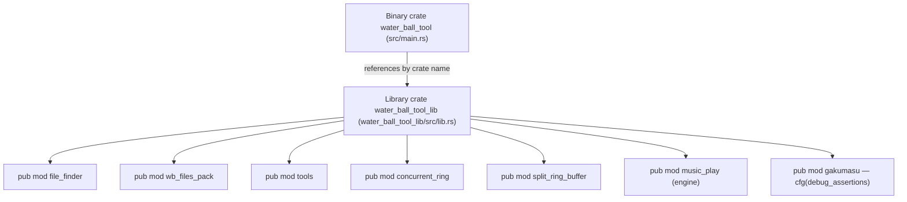
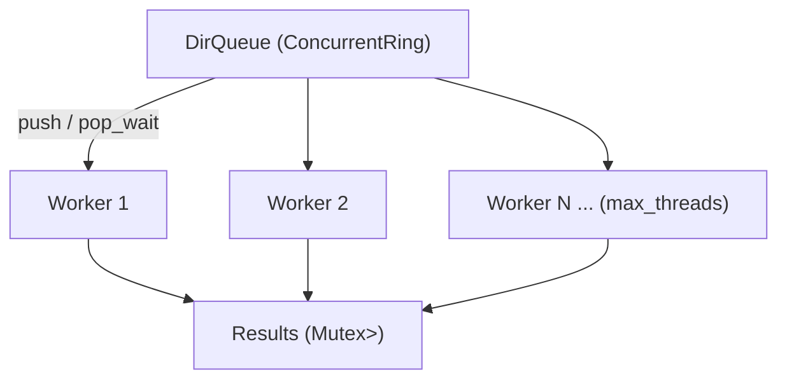
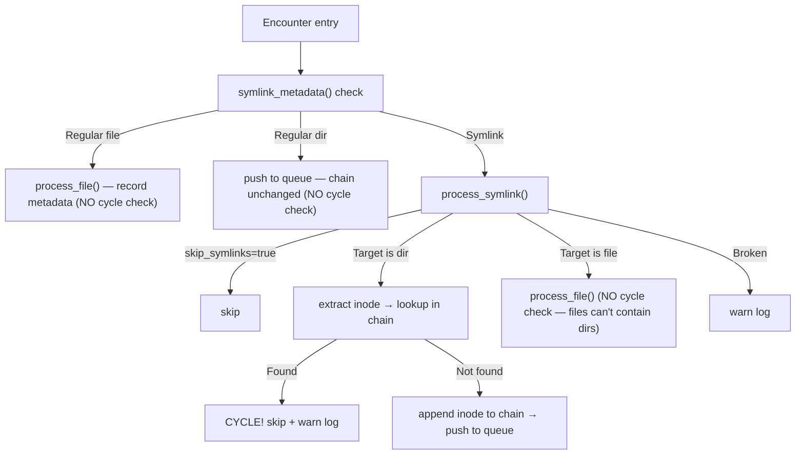
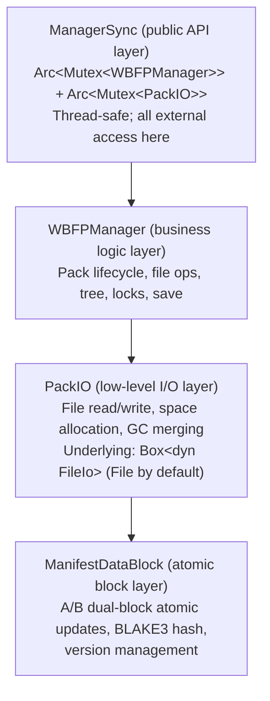
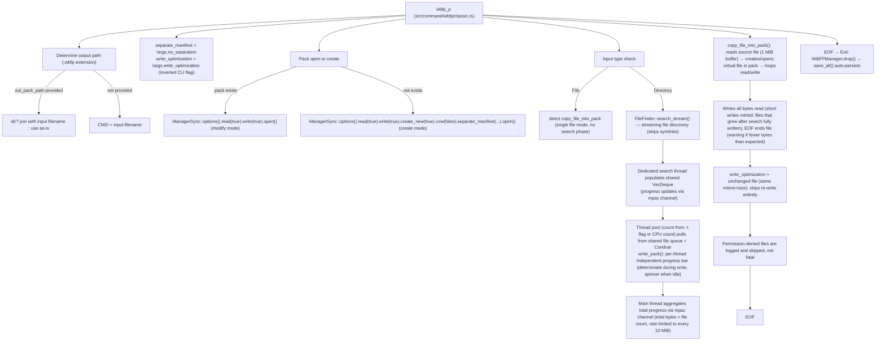
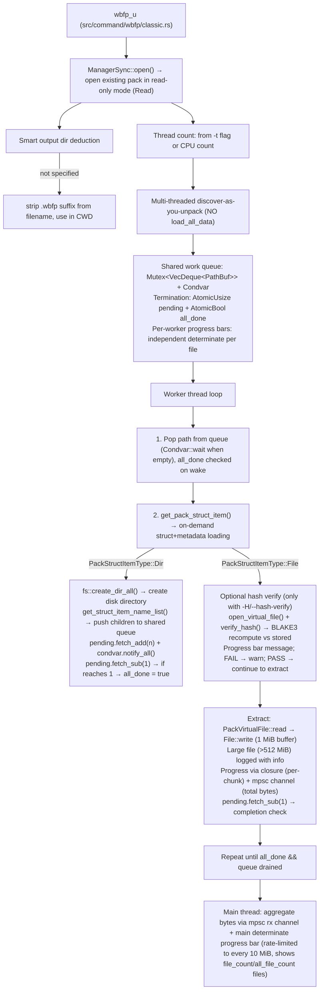
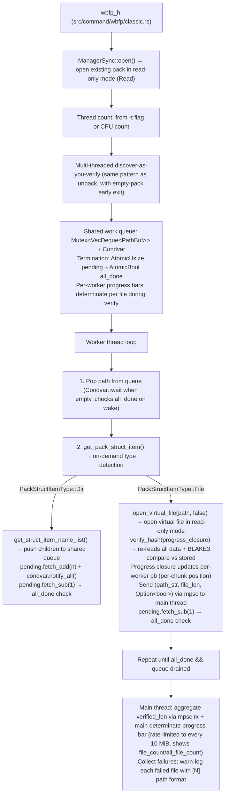
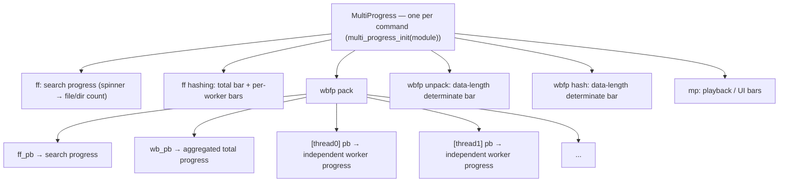
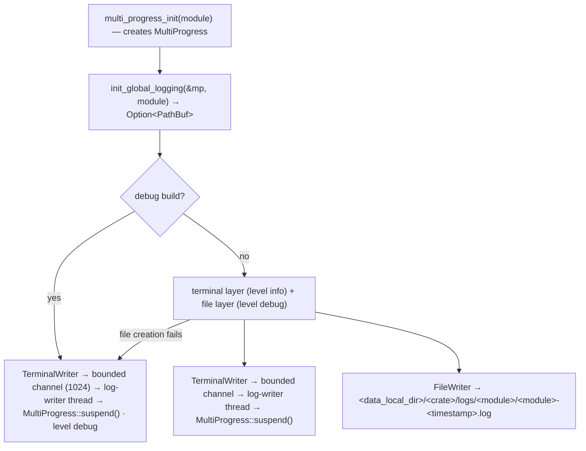

# WaterBall Tool — Architecture

> **Language**: English | [简体中文](docs/zh_CN/ARCHITECTURE.md)

> Last Updated: 2026-11-06

---

## Table of Contents

1. [Overview](#1-overview)
2. [Tech Stack](#2-tech-stack)
3. [Module Dependency Graph](#3-module-dependency-graph)
4. [Workspace: Binary vs Library Crate](#4-workspace-binary-vs-library-crate)
5. [Entry Point & CLI Routing](#5-entry-point--cli-routing)
6. [File Finder (`ff`)](#6-file-finder-ff)
7. [Music Player (`mp`)](#7-music-player-mp)
8. [WaterBall Files Pack (`wbfp`)](#8-waterball-files-pack-wbfp)
9. [Progress Bar System](#9-progress-bar-system)
10. [Logging System](#10-logging-system)
11. [Tools Module](#11-tools-module)
12. [Ring Buffer Modules](#12-ring-buffer-modules)
13. [Work-in-Progress Modules](#13-work-in-progress-modules)
14. [Test Architecture](#14-test-architecture)
15. [Design Decisions & Tradeoffs](#15-design-decisions--tradeoffs)

---

## 1. Overview

WaterBall Tool is a multi-purpose CLI toolkit written in **Rust (edition 2024)**. It currently provides three core
features:

- **`ff`** — Multi-threaded parallel file finder, emits a JSON file manifest with symlink cycle detection and optional
  per-file hashing
- **`wbfp`** — Custom binary archive format (WaterBall Files Pack): pack, unpack, BLAKE3 hash verification, and a
  read-only TUI browser
- **`mp`** — Terminal music player: audio playback with playlist modes, an interactive ratatui TUI, and a realtime-safe
  audio thread architecture

The repository is a cargo **workspace**: the `water_ball_tool` binary crate (CLI entry, `src/`) depends on the
`water_ball_tool_lib` library crate (`water_ball_tool_lib/src/`), which exposes the reusable modules.


> Portions generated by AI (deepseek-v4-pro), delimited by `//AI===` / `//AI_END===`.

---

## 2. Tech Stack

| Category          | Crate                                                     | Purpose                                                                          |
|-------------------|-----------------------------------------------------------|----------------------------------------------------------------------------------|
| CLI               | `clap 4.6` (derive)                                       | Argument parsing                                                                 |
| Serialization     | `serde` / `serde_json`                                    | Data structures, JSON output                                                     |
| Hashing           | `blake3 1.8`                                              | Pack file data integrity                                                         |
| Hashing (CLI)     | `sha1` / `sha2` / `blake2b_simd` / `md-5` / `crc32fast`   | `ff` per-file hash algorithms                                                    |
| Progress bars     | `indicatif 0.18`                                          | Terminal spinners & progress bars                                                |
| Logging           | `tracing` / `tracing-subscriber`                          | Structured logging (env-filter) + optional log files                             |
| Process detection | `sysinfo 0.39`                                            | PID liveness check for lock files                                                |
| Random            | `rand 0.10`                                               | Randomized test data (longtime tests: random tree search stress, large fixtures) |
| Test utils        | `pretty_assertions 1.4`                                   | Diffable assertion output                                                        |
| Audio             | `cpal 0.18` / `symphonia 0.6` / `rubato 5` / `lofty 0.25` | Audio output, decoding, resampling, tag reading                                  |
| Terminal UI       | `ratatui 0.30` / `vtparse 0.7`                            | Interactive `mp` + `wbfp` TUIs + Windows VT input                                |
| Thread channels   | `crossbeam-channel 0.5`                                   | Realtime-safe bounded channels (audio callbacks)                                 |

---

## 3. Module Dependency Graph

```
water_ball_tool (binary crate, root package)
  ├── src/main.rs          ← CLI entry; declares `mod command;`
  ├── src/command.rs       ← CLI routing + progress bar helpers
  │   ├── command/ff.rs    ← ff subcommand (search + optional hashing)
  │   ├── command/wbfp.rs  ← wbfp module root (args + TUI/classic routing)
  │   │   └── command/wbfp/
  │   │       ├── classic.rs   ← classic indicatif path
  │   │       ├── common.rs    ← shared path/copy/extract helpers
  │   │       ├── events.rs    ← TUI job events + row status
  │   │       ├── ops.rs       ← TUI pack/unpack/verify workers
  │   │       └── tui/         ← TUI (tui.rs, app.rs, ui.rs, browse.rs)
  │   ├── command/tui_input.rs   ← shared TUI input (mouse capture, VT parser, hit-test)
  │   ├── command/music_play.rs  ← clap args + TUI wiring
  │   │   └── command/music_play/
  │   │       ├── runtime.rs         ← playback runtime (event sinks, snapshot)
  │   │       ├── scanner.rs         ← background tag scan (lofty → ScanMessage)
  │   │       └── tui/               ← terminal UI (tui.rs, app.rs, ui.rs, channel_writer.rs)
  │   └── command/test.rs  ← integration tests
  └── depends on:
      water_ball_tool_lib (library crate, workspace member)
        ├── src/file_finder.rs          ← file search core
        │   └── file_finder/test.rs     ← symlink tests
        ├── src/wb_files_pack.rs        ← WBFP module root
        │   ├── data.rs                 ← core data types (1762 lines, largest module)
        │   ├── error.rs                ← error types
        │   ├── manager.rs              ← WBFPManager
        │   │   ├── open.rs             ← create/open pack files
        │   │   ├── save.rs             ← progressive save + throttling
        │   │   ├── file_ops.rs         ← virtual file creation + dir creation
        │   │   ├── tree.rs             ← directory tree traversal + lazy loading
        │   │   ├── metadata.rs         ← file handle creation + metadata update
        │   │   ├── lock.rs             ← process-level write lock
        │   │   ├── gc.rs               ← GC orchestration
        │   │   ├── delete.rs           ← virtual file/dir delete + erase
        │   │   └── test.rs             ← internal API tests
        │   ├── manager_sync.rs         ← public API layer (Arc<Mutex<>>)
        │   │   └── test.rs             ← public API tests
        │   ├── pack_io.rs              ← low-level file I/O + space allocation + GC merging
        │   │   ├── file.rs             ← FileIo trait (pack backend abstraction)
        │   │   ├── pack_file.rs        ← PackVirtualFile (access mode enforcement)
        │   │   ├── file_handle.rs      ← PackFileHandle (493 lines, core file logic)
        │   │   └── file_hash.rs        ← PackFileHash (BLAKE3 state machine)
        │   ├── net_server.rs           ← network server (WIP, debug builds only)
        │   └── test.rs                 ← module-level tests
        ├── src/tools.rs                ← path utilities + byte formatting + test helpers
        ├── src/concurrent_ring.rs      ← concurrent initializable ring buffer
        ├── src/split_ring_buffer.rs    ← split lock/lock-free read-write ring buffer
        │   └── inner / reader / writer / mode / error / test
        ├── src/music_play.rs           ← music player engine root (LoopMode + module tree)
        │   ├── player.rs               ← cpal stream + transport + try_stop
        │   ├── decoder_runtime.rs      ← symphonia decode thread
        │   ├── effect.rs               ← effect traits / audio types
        │   │   └── effect/             ← resampler / cross_bridge / fade / runtime
        │   ├── play_list.rs            ← tracks + loop/shuffle modes
        │   ├── event_dispatch.rs       ← realtime event/log dispatch thread
        │   └── tools.rs                ← time metrics / duration accumulators
        └── src/gakumasu/               ← game simulator (WIP, debug builds only)
            ├── data.rs
            └── simulator.rs
```

---

## 4. Workspace: Binary vs Library Crate

```
Cargo.toml                       → [workspace] resolver = "3", members = ["water_ball_tool_lib"]
                                   + [package] "water_ball_tool" (binary, src/)
water_ball_tool_lib/Cargo.toml   → [package] "water_ball_tool_lib" (library)
```

**Key Rules**

- The root package is the binary crate `water_ball_tool`; `main.rs` declares `mod command;` — `command.rs` is
  **private** to the binary crate.
- The library crate `water_ball_tool_lib` exports: `file_finder`, `wb_files_pack`, `tools`, `concurrent_ring`,
  `split_ring_buffer`, `music_play`, and `gakumasu` (gated under `#[cfg(debug_assertions)]` — only compiled in debug
  builds).
- Binary code references library code via crate-name-qualified paths — `water_ball_tool_lib::file_finder`,
  `water_ball_tool_lib::wb_files_pack`, `water_ball_tool_lib::tools`, `water_ball_tool_lib::music_play`, … — **not**
  `crate::file_finder`.
- Both packages share metadata and dependencies through `[workspace.package]` / `[workspace.dependencies]`.

**Dependency Flow**



---

## 5. Entry Point & CLI Routing

### `main.rs` — Entry Point (344 lines)

```
1. Cli::parse()        — clap derive parses CLI args
2. command::cli(cli)   — routes to the subcommand handler
3. subcommand handler  — classic paths call multi_progress_init(module) to build the MultiProgress and install
                         the global tracing subscriber; the wbfp/mp TUIs install the TUI channel writer instead
4. Err wrapper         — prints the error and exits with code -1
```

Log levels and log-file routing are configured inside `init_global_logging(&mp, module)` — see §10.

### `command.rs` — CLI Routing (100 lines)

```rust
Cli {
    command: Commands::Ff(FileFinderArgs) | Commands::Wbfp(WaterBallFilePackCommand)
           | Commands::MP(music_play::MusicPlayArgs)
}
```

Progress bar helpers

| Function                       | Purpose                                                     |
|--------------------------------|-------------------------------------------------------------|
| `create_pb(mp) -> ProgressBar` | Create and register an auto-ticking spinner (100 ms tick)   |
| `progress_style(template)`     | Build a `ProgressStyle`; invalid template → default + error |

Constants

| Constant                       | Value  | Purpose                                                          |
|--------------------------------|--------|------------------------------------------------------------------|
| `BUF_LEN`                      | 10 MiB | Read/write buffer size                                           |
| `PACK_PROGRESS_STYLE_TEMPLATE` | —      | Pack/unpack/hash bar template (prefix, bar, ETA, percent, bytes) |
| `SPINNER_TEMPLATE`             | —      | Idle/suspended worker spinner template                           |

---

## 6. File Finder (`ff`)

### 6.1 Multi-Threaded Work Queue Model

Architecture: **shared work queue + blocking pop** pattern. The queue is a `ConcurrentRing<DirEntry>` (see §12.1);
there is no separate condition variable or running-thread counter.



**Worker lifecycle**

1. On spawn: enter the loop
2. Loop: `pop_wait()` from the queue (blocks while it is empty)
3. A pushed directory wakes one blocked worker
4. Queue empty and no other worker can push → `pop_wait()` returns `WritersClosed` / `AllWaiting` → thread exits

**Progress rate limiting**: fires every 50 files / 10 dirs via `pb.send((delta_files, delta_dirs))`.

**Command-layer thread creation**: the `ff` handler's result-collector, progress-aggregator and hash-worker threads are
created with `thread::Builder::new().name(...).spawn(...)` and spawn failures propagate as errors (the panicking
`std::thread::spawn` is forbidden); taking a worker progress bar that must exist is a logic error and aborts via
`unreachable!`.

### 6.2 Symlink Cycle Detection

Each worker thread maintains an independent **inode chain** (`Vec<InodeKey>`) carried by `DirEntry`:

```rust
struct DirEntry {
    path: PathBuf,
    symlink_chain: Vec<InodeKey>,  // inodes of dirs entered via symlinks on this path
}                                  /
```

**Detection flow**



**Platform differences**

| Platform | InodeKey type | Extraction method                          |
|----------|---------------|--------------------------------------------|
| Unix     | `u128`        | `(dev << 64) \| ino`                       |
| Windows  | `PathBuf`     | `canonicalize()` fallback to original path |

> **Rationale**: Regular directories cannot form cycles in a normal filesystem; only symlinks can close a loop. This
> keeps the detection mechanism scoped exactly where it matters, with zero overhead on normal files and directories.

### 6.3 Core Data Structures

```rust
pub struct FilesList {
    path: String,                            // Root search path
    data_length: u64,                        // Total data size
    file_count: u64,                         // File count (excl. dirs)
    dir_count: u64,                          // Directory count
    files_list: HashMap<String, FileInfo>,   // Direct children of root
}

pub struct FileInfo {
    name: String,           // Name (without path)
    length: u64,            // File=actual size, Dir=cumulative child total
    modified_time: u128,    // ms since UNIX epoch
    file_kind: FileKind,
}

pub enum FileKind {
    File {
        hash: Option<HashMap<String, String>>,  // Per-file hashes (only when [HASH]... is given)
    },
    Dir(Dir),
}

pub struct Dir {
    files_list: HashMap<String, FileInfo>,  // Direct children
    file_count: u64,                        // Cumulative descendant file count
    dir_count: u64,                         // Cumulative descendant dir count
}
```

### 6.4 Streaming Search API

| Feature               | `search()`                  | `search_stream()`                             |
|-----------------------|-----------------------------|-----------------------------------------------|
| `FilesList` tree      | `Some(results)` — full tree | `None` (skips HashMap)                        |
| `HashMap` (in-memory) | Collected                   | None — zero overhead                          |
| Blocking, one-shot    | Yes                         | No — returns `(JoinHandle, Receiver<...>)`    |
| Used by               | `ff` command                | `wbfp` pack, `ff` hashing (producer-consumer) |

### 6.5 Tree Rebuilding

Parallel scan produces a flat `HashMap<PathBuf, FileInfo>`. `build_tree()` reconstructs the nested `FilesList`:

1. Group all entries by parent path → `HashMap<PathBuf, Vec<PathBuf>>`
2. Iterative stack-based post-order build (Pre/Post state machine with explicit `Fr` frames) — avoids stack overflow on
   deeply nested hierarchies; parent-child linkage uses `rposition()` backward search for correct path matching
3. Directory `length` = sum of all descendant file sizes
4. Directory `file_count`/`dir_count` = cumulative across all subdirectories

### 6.6 Hash Computation

- CLI: the optional multi-value positional `[HASH]...` argument (after `[OUT_PATH]`) accepts `all`, `md5`, `sha256`,
  `sha512`, `sha1`, `blake3`, `blake2b`, `crc32` (aliases `*`, `m5`, `s256`, `s512`, `s1`, `b3`, `b2b`, `crc`).
- Implementation (`command/ff.rs`): `HashTypeS` holds one hasher per selected algorithm and exposes `update`, `reset`,
  and `finalize_reset_str_map` (hex strings), so multiple algorithms share a single read pass.
- `search_stream()` is called with `ff_thread_count = 1` when hashing is enabled; discovered file entries are pushed
  into a `ConcurrentRing`, and `thread_count` hash workers (from `-t/--thread-count` or available parallelism) pop
  entries, read each file with a 10 MiB buffer, compute the hashes, and insert a new `FileInfo` with
  `FileKind::File { hash: Some(map) }` into the result map.
- The main thread aggregates per-worker progress over an mpsc channel (rate-limited to every 10 MiB).
- Selecting MD5/SHA-1 logs an insecurity warning. Every code path (open failure, read failure, EOF mismatch, channel
  disconnect) resets the hashers so the next file starts clean.

---

## 7. Music Player (`mp`)

**Files**: engine in `water_ball_tool_lib/src/music_play/` (~3,100 lines); terminal front-end in
`src/command/music_play.rs` + `src/command/music_play/` (~850 lines)

### 7.1 Overview

`mp` is a terminal music player. The command:

1. Validates the volume argument and installs the TUI logging subscriber (records go into the panel, see §7.7).
2. Creates `Runtime` (player + playlist + event sinks) and spawns the `mp-scan` thread, which walks `files...`, reads tags
   with `lofty` (directories only accept extensions `lofty` recognizes; an explicitly passed file is always tried) and
   sends `ScanMessage::{Track, Progress, Done}` to the TUI loop.
3. Initializes the terminal and runs `tui::run`: drain logs/scan messages → apply the runtime snapshot → render every
   50 ms. Initialization loads the first track paused: sequential modes do it as soon as the first track arrives,
   `shuffle`/`periodic-shuffle` wait for 5 tracks and fall back to initializing with whatever was found when the scan
   ends. Playback starts only with `-a/--autoplay` (or when the user presses play). Keys: `n` next, `←`/`→` seek
   (5 s per tap; a hold previews and commits on release), space play/pause, `p` pause, `P` play, `+`/`-` volume,
   `:` command mode, `q`/`Esc`/`Ctrl+C` quit.

CLI arguments (`MusicPlayArgs`):

| Argument             | Default           | Purpose                                                                                 |
|----------------------|-------------------|-----------------------------------------------------------------------------------------|
| `files...`           | —                 | Audio files and/or directories to play                                                  |
| `-v, --volume <f32>` | `0.75`            | Initial volume, 0.0–1.0 (values outside this range are rejected with an argument error) |
| `--verbose`          | off               | Verbose output (long option only)                                                       |
| `-a, --autoplay`     | off               | Start playing once the first track is found; without it the first track is loaded paused |
| `-m, --mode <MODE>`  | `sequential-loop` | `sequential-loop`, `sequential`, `repeat-one`, `shuffle`, `periodic-shuffle`            |

### 7.2 Modules

The playback engine lives in the library crate and has no dependency on the terminal UI; only `runtime.rs`, `scanner.rs`,
the clap handler and `tui/` stay in the binary.

| Module (crate)                 | Responsibility                                                                                                                                                                                                                    |
|--------------------------------|-----------------------------------------------------------------------------------------------------------------------------------------------------------------------------------------------------------------------------------|
| `music_play.rs` (lib)          | Engine module root; owns `LoopMode` (with `FromStr`) and declares the submodules                                                                                                                                                  |
| `player.rs` (lib)              | cpal output stream, `PlayCmd` transport, volume/position atomics, event sinks, `Player::try_stop`                                                                                                                                 |
| `decoder_runtime.rs` (lib)     | symphonia decode thread: probes/seeks the file, decodes audio into the pre-effect ring buffer; owns the paired `DecoderSession`                                                                                                   |
| `effect.rs` (lib)              | `PostEffect`/`PreEffect` traits, `AudioFormat`, `PlayCmd`, effect chain                                                                                                                                                           |
| `effect/runtime.rs` (lib)      | Locked pre-effect runtime thread (event sinks, stop/reject handling)                                                                                                                                                              |
| `watchdog.rs` (lib)            | Crash watchdog: `ThreadExitGuard` (Drop → notify on a `Condvar`) + single watchdog thread owned by `Player`                                                                                                                       |
| `effect/resampler.rs` (lib)    | rubato FFT resampler to the output device sample rate                                                                                                                                                                             |
| `effect/cross_bridge.rs` (lib) | Crossfade bridging between tracks: asymmetric delay-line fill (low startup latency) and full-curve gain scaling for short tails                                                                                                   |
| `effect/fade.rs` (lib)         | Fade in/out and pause/resume transport handling                                                                                                                                                                                   |
| `play_list.rs` (lib)           | `Track` list, loop modes, shuffle queues, next-track selection, navigation history for the previous track, `jump_to` (periodic shuffle removes the target from the current cycle when queued), add/insert                         |
| `event_dispatch.rs` (lib)      | Dedicated dispatch thread for realtime-callback events and logs                                                                                                                                                                   |
| `tools.rs` (lib)               | `TimeMetrics` / `DurationAccumulator` profiling counters                                                                                                                                                                          |
| `runtime.rs` (bin)             | TUI playback runtime: player + shared playlist, `add_track`/`play`/`pause`/`next_track`/`prev_track`/`seek`/`set_loop_mode`/`snapshot`/`stop`, seamless auto advance on decode Eof (`no_clear`), start-error policy, no UI thread |
| `scanner.rs` (bin)             | `mp-scan` thread: tags/album/audio info via lofty → `ScanMessage::{Track, Progress, Done}`                                                                                                                                        |
| `tui/` (bin)                   | Terminal UI (`tui.rs`, `app.rs`, `ui.rs`, `channel_writer.rs`): 50 ms loop, rendering, key map, log channel                                                                                                                       |

### 7.3 Realtime Audio Thread

Data flows from the decode thread → pre-effect ring buffer → pre-effect runtime → split ring buffer (lock-free read
side) → cpal callback → device.

The cpal callback runs in a realtime context and therefore:

- never takes a blocking lock (it uses `try_lock` on the effect chain and the split ring buffer's lock-free reader),
- never invokes `PlayerEventSink` directly,
- never writes logs.

The split ring buffer's lock-free read path publishes `read.pos` and then checks for waiting writers. That check is
bracketed by a `SeqCst` fence on both sides (publisher in `notify_*_after_*`, waiter in `enter_wait`), so "publisher
skipped the wakeup" and "waiter read a stale position" cannot happen together — a missed wakeup would park the peer
forever. Only a fence is used, never a lock, so the callback path stays realtime-safe.

Instead it posts events (`TrackEnded`) and log records with non-blocking `try_send` into the `EventDispatcher`'s
bounded channel (`DISPATCH_CHANNEL_CAPACITY = 1024`). A full channel drops the message and increments the dropped
counter (reported at debug level on stop).

The `player-event-dispatch` thread performs the real work: locking the sink list, invoking `PlayerEventSink::emit`, and
emitting `tracing` events (including stream errors) through the normal logging pipeline.

Transport commands (`PlayCmd::{Play, Pause, Seek, ClearEofBuf}`) travel from the command side to the callback over a
bounded crossbeam channel; accepted commands are reported back on an unbounded channel to the `rx_cmd` thread, which
drives `stream.play()` / `stream.pause()`.

### 7.4 Decoder Runtime & Error Propagation

- The decoder keeps its symphonia engine (format reader + decoder) and its data (track metadata) together in one
  `DecoderSession` stored in a single `Arc<Mutex<Option<DecoderSession>>>`. Track changes replace or take the whole
  session under that one lock, so an "engine present but data missing" state cannot occur. The old split
  `engine`/`data` `Option` pair and its missing-data branch are gone.
- The decoder batches interleaved samples in its internal `out_buf` until it reaches the pre-effect chain's
  `min_input_len_work()` hint (the chain takes the maximum over its effects) before pushing a `Block`. The hint is
  advisory, not a guarantee that smaller inputs produce no output: that depends on the effect, and an effect without
  internal buffering may process every packet; `0` means no accumulation is required. Debug readings include the
  decoder-internal buffer, the decode→pre-effect queue, the pre-effect delay lines and the playback ring.
- `DecoderRuntime::run()` and `PreEffectRuntime::run()` return `Result`; a failed thread spawn aborts `Player::new()`
  with an error instead of being logged and ignored.
- Decode-loop error policy:
    - transient IO errors (see `DecoderRuntime::is_retryable_io_error`, e.g. Windows 1450 `ERROR_NO_SYSTEM_RESOURCES`)
      are retried up to 5 times with a 200 ms delay before being treated as failures;
    - real runtime failures that cannot be retried, or whose retries are exhausted — `next_packet` error, a genuine
      ring-buffer write failure, a failed EOF push, or a fatal (non-frame-level) decode error — emit a `DecoderEvent`
      error, then take the session, clear the pending output buffer and return to the condvar wait; the decode thread
      stays alive, so a later track change plays;
    - the same failures set the atomic `poisoned` flag (`DecoderRuntime::is_poisoned`). A successful
      `DecoderRuntime::set_decoder_path` clears it automatically, so the front-end cannot forget the cleanup and turn a
      later play command into a premature track change;
    - a single-frame `DecodeError` is recoverable: it is reported and the frame is skipped;
    - `WriteRejected` during stop, track change, or seek is normal control flow, not an error.
- The binary front-end consumes decoder error events through a `DecoderEventChannelSink` (channel thread, never inline
  on the decode thread) and pauses playback. The next `play` sees `is_poisoned()` and changes track first, then starts
  playback; the TUI shows the `异常暂停中` state and a red `Error` line in the now-playing block.
- `DecoderRuntime::stop()` records a `send_skip` failure, always joins the decode thread, then returns the first error;
  `Player::try_stop` logs stop failures and continues the remaining shutdown steps.
- The pre-effect runtime thread never exits on a runtime error: a ring error resets the effect chain with the `Skip`
  discontinuity, emits `PreEffectRuntimeEventErrorKind::Runtime`, backs off 10 ms and keeps consuming (a closed write
  side therefore parks instead of spinning); a hard output-write error is reported the same way and the block is
  dropped. Only the `stop` flag ends the loop. The binary logs these events through a
  `PreEffectRuntimeEventChannelSink` (informational — playback may continue). The chain lock is released before the
  blocking output-ring write, so the UI can snapshot effect metadata even while paused with a full ring.
- Event-channel sink constructors (`PlayerEventChannelSink::create`, `DecoderEventChannelSink::create`,
  `PreEffectRuntimeEventChannelSink::create`) return `Result`; direct sinks construct infallibly. `Player::new()` and
  `Runtime::new()` propagate sink and thread spawn failures.

### 7.5 Shutdown (`Player::try_stop`)

`try_stop()` is idempotent and reclaims every thread in a fixed order:

1. Shut the watchdog down (`WatchNotify::shutdown`), so it cannot restart a thread during shutdown.
2. Pause the audio stream and clear `is_playing`, so no new events are produced.
3. Stop the pre-effect runtime — its `reject_waiting_writers` wakes producers blocked in `push_wait`, preventing a join
   deadlock.
4. Stop the decoder thread.
5. Stop the event dispatch thread (`Stop` message + join).
6. Join the `rx_cmd` thread via the handle stored in the player.
7. Join the watchdog thread.

Failures at any step are logged, not propagated; `Runtime::run_stop` additionally joins the UI thread.

### 7.6 Crash watchdog (`watchdog.rs`)

- A watched thread (`decoder-runtime`, `pre-effect-running`) owns a `ThreadExitGuard` inside its closure. On `Drop`
  (panic unwind included) the guard sets its slot bit in `WatchNotify` and wakes the single watchdog thread on a
  `Condvar` — no `JoinHandle::is_finished()` polling, no second thread.
- `Player::new` injects the notifier into both runtimes before `run()` and spawns `player-watchdog`.
- On exit the watchdog pauses playback (it never resumes automatically), sets the decoder poison flag so `Play`
  recovers by changing track, and restarts the dead thread (`run()` reclaims the finished `JoinHandle` first). For the
  pre-effect runtime the whole effect chain is rebuilt through the factory registered by `Player::new` before the
  restart, because the old effects may already be poisoned.
- `try_stop` shuts the watchdog down before stopping the threads and joins it last, so a normal shutdown never triggers
  a restart.

### 7.7 TUI

**Files**: `src/command/music_play/tui/` (`tui.rs`, `app.rs`, `ui.rs`, `channel_writer.rs`)

- `tui::run` polls every 50 ms, drains log and scan messages, applies `Runtime::snapshot()` and renders now playing /
  progress with a compact volume gauge / playlist / reserved right pane / key hints
- TUI state is grouped in `App` by responsibility (`playback`, `playlist`, `scan`, `seek`, `footer`, `mouse`, `command`,
  `effects`, `debug`). A single `Window` enum (`None`/`Help`/`Debug`/`Effects`) replaces the window booleans. Key
  routing
  is exclusive: command input first, then `Esc` closes the active window; `Window::None` goes to the main-view handler
  and
  each open window has its own handler, so window keys never fall through to the main view.
- Playlist viewport: only the visible rows are rendered; `↑`/`↓` scroll one line, `PageUp`/`PageDown` one page,
  `Home`/`End` jump to the ends, the mouse wheel scrolls three lines and a left double-click on a row switches to and
  plays that track (`Runtime::play_at` → `PlayList::jump_to`). The footer hint labels are clickable buttons for quit,
  next,
  play/pause, debug, effects and command mode. The viewport follows the current track when the track changes; manual
  scrolling is kept until then. Mouse capture, the VT parser (`VtInput`/`VtEvent`), double-click state (`MouseState`),
  the bordered-list hit-test (`list_index_at`) and the wheel step live in `command/tui_input.rs` and are shared with
  `wbfp`. Capture is enabled around the TUI loop and released before the terminal is restored. On Windows the TUI
  enables `ENABLE_VIRTUAL_TERMINAL_INPUT`, requests SGR mouse reporting and parses the VT byte stream with `vtparse`;
  this avoids crossterm's console mouse records, which some ConPTY terminals
  deliver as bare X10 payload bytes. Under VT input the TUI reads stdin bytes directly (a dedicated reader thread)
  instead of `crossterm::event`, because crossterm 0.29 drops control characters such as ESC and CR from synthesized VT
  input; a lone ESC becomes the Esc key only after a short timeout. If VT input cannot be enabled, the mouse is disabled
  and keyboard input keeps working
- Startup: sequential modes initialize (load the first track) on the first track; shuffle modes wait for 5 tracks, with
  a `ScanMessage::Done` fallback that initializes with fewer tracks when the scan ends
- Key map: `n` next, `←`/`→` seek (5 s per tap; repeats during a hold only move the preview and the target is
  committed on release), space play/pause, `p` pause, `P` play, `↑`/`↓`/`PageUp`/`PageDown`/`Home`/`End` scroll the
  playlist, `+`/`-` volume, `F12` toggles the debug popup, `e` toggles the effects window, `:` command mode,
  `q`/`Esc`/`Ctrl+C` quit. Debug/effects/help windows are mutually exclusive: opening one closes the others, and `Esc`
  closes the active window before quitting. The Debug window is two-column: buffers, decoder state, latency pipeline and
  `TimeMetrics` on the left; the live log on the right. It shows each buffer's occupancy over capacity, the decoding
  path/format and the playback (device) format, playlist
  state, buffer-based latency estimates (decoder-internal buffer, decode→pre-effect queue, pre-effect delay lines,
  playback ring plus the last callback block, and their sum, drawn as a proportional pipeline bar from decode to
  playback), per-stage timings (`TimeMetrics` windows), `lock_fail` and `underrun`
- Progress row: the position bar is drawn per cell with eighth blocks (`█▉▊▋▌▍▎▏`), so it resolves to 1/8 of a cell;
  the time/percent label sits to the right of the bar, so no text is drawn over it and the bar stays continuous (a long
  label leaves at least 8 cells for the bar and is truncated). The shared `command::render_eighth_block_bar` helper is
  also used by the `wbfp` job card. The volume gauge stays a plain bar.
- Effects window: `e` (or `:effects`) opens a two-column view. The left column lists the pre-effect chain first and the
  post-effect chain after it, showing only the human-readable name and enabled state; `↑`/`↓` and
  `PageUp`/`PageDown` move the selection, and the window title repeats the `↑`/`↓` hint. The right column shows the
  selected effect's chain, current delay, description and a settings section. `Space`/`Enter` asks for a toggle; the UI
  does not update optimistically and waits for the next snapshot. Pre-effect toggles are queued on a dedicated command
  channel and applied by the effect thread before the next audio block; a disable first lets the effect drain its
  internal buffer via `PreEffectDiscontinuity::DisableSelf`, then passes the drained samples through downstream
  `UpstreamDisabled { distance }` handlers. A non-destructive writer wake interrupts a blocked output write without
  clearing it; the effect thread keeps the unwritten remainder in a pending output cache, handles the command, and then
  resumes writing the cache before new audio, so a toggle cannot truncate a block. Downstream is not reset unless the
  effective format changes, and a
  format-changing effect (the resampler) is statically `Forbidden` instead of being bypassed. Post effects are strictly
  synchronous and toggle directly. Rows are built only from `PreEffect`/`PostEffect` trait methods (`display_name`,
  `description`, `enabled`, `disable_policy`, `buffered_samples`, with the manager-registered input format), so a newly
  added effect appears without changing the UI. Other settings are deferred to a dedicated trait design.
- Command mode: `:` turns the footer into an input line (`Enter` runs, `Esc` cancels, `Backspace` edits). Commands match
  by unique prefix: `quit`, `play`, `pause`, `toggle`, `next`, `prev`, `seek <mm:ss|+N|-N>`, `vol <0-100|+N|-N>`,
  `mode <name>`, `goto <n>`, `debug`, `effects` and `help`/`?`; an unknown or ambiguous name is reported in the footer.
  `help` opens
  a popup listing the command table, `prev` steps back through `PlayList::prev`'s history, `goto` reuses
  `Runtime::play_at` and `mode` calls `Runtime::set_loop_mode`. `:seek` calls `Runtime::seek` → `Player::try_seek`,
  which clears the output ring, runs the decoder's accurate seek with a basic `Seek` effect reset, invalidates the EOF
  state and rebases the progress counter; the reported position is approximate by one audio block. `Runtime::seek`
  ignores requests during a track switch or while the EOF tail/crossfade is draining, because `pos` still counts the
  previous track in that window.
- `channel_writer` owns the tracing subscriber (bounded 1024, `try_send` drops when full); the panel dims the timestamp
  and colors the level token by severity. Debug builds write `debug` records to `temp/logs/<module>/` under the project
  (from `CARGO_MANIFEST_DIR`); release builds keep the panel at `info` and write the `debug` file to the user data
  directory
- `mp` chains a panic hook and logs `tui::run` errors at `error` level so a crash leaves a trace in the log file; key
  and mouse events are logged at `debug`

---

## 8. WaterBall Files Pack (`wbfp`)

**Files**: `water_ball_tool_lib/src/wb_files_pack/*.rs` (~6,000+ lines total) plus the binary-crate front end
`src/command/wbfp/*` (classic progress-bar path, TUI, operations).

### 8.1 Overall Architecture

WBFP uses a **three-layer architecture**



### 8.2 Binary Format

Full specification at `docs/en_US/wb_files_pack/manifest-data.md`. Summary:

```
.pack file layout
┌────────────────────────────────────────────────────────┐
│  FILE_HEADER_BLOCK_LEN (128 + attribute block)         │
│  ├─ File header: magic "WBFilesPack", ver [0,2]        │
│  │   ├─ type_name (11B)                                │
│  │   ├─ version (2B)                                   │
│  │   ├─ bool_data (1B) — cow bit[0], s_manifest bit[1] │
│  │   ├─ pack_len (8B)                                  │
│  │   └─ padding to 128B                                │
│  └─ Embedded Attribute manifest data block             │
├────────────────────────────────────────────────────────┤
│  Data Region                                           │
│  ├─ File data blocks (DATA_DATA_BLOCK_LEN-aligned)     │
│  └─ (optional) manifest data (when !separate_manifest) │
├────────────────────────────────────────────────────────┤
│  Manifest Index                                        │
│  ├─ DataPosList (data free region list)                │
│  ├─ DataPosList (manifest free list, separated only)   │
│  ├─ PackStruct (root directory)                        │
│  │   └─ PackStructItem ... (recursive)                 │
│  └─ PackFileMetadata ... (per file/dir)                │
└────────────────────────────────────────────────────────┘
```

**Key Constants**

| Constant                      | Value | Purpose                         |
|-------------------------------|-------|---------------------------------|
| `DATA_BLOCK_LEN`              | 128 B | Manifest data alignment unit    |
| `DATA_DATA_BLOCK_LEN`         | 4 MiB | File data allocation unit       |
| `MANIFEST_VERSION`            | 10    | Current manifest format version |
| `MANIFEST_VERSION_COMPATIBLE` | 10    | Minimum compatible version      |

### 8.3 Core Data Structures

```rust
/// Top-level manifest
pub struct WBFilesPackManifest {
    attribute: Attribute,         // Global attributes (always resident)
    root_struct: PackStruct,      // Root directory structure
    file: Option<PackIO>,         // Manifest file I/O (separated mode)
}

/// Global attributes — pack file metadata
pub struct Attribute {
    version: u16,                              // Format version
    version_compatible: u16,                   // Compatible version
    cow: bool,                                 // Copy-on-write
    empty_data_pos_list_pos: u64,              // Data free-list position
    manifest_empty_data_pos_list_pos: u64,     // Manifest free-list position
    manifest_file_len: u64,                    // Manifest file length
    root_struct_pos: u64,                      // Root struct position
    file_count: u64,                           // Total files
    dir_count: u64,                            // Total dirs
    data_len: u64,                             // Total data size
    data_block: ManifestDataBlock,
    dirty: bool,                               // Dirty flag
}

/// Directory structure node
pub struct PackStruct {
    items: HashMap<String, PackStructItem>,    // Children
    data_block: ManifestDataBlock,
    dirty: bool,
}

/// Directory entry
pub struct PackStructItem {
    name: String,
    metadata_file_pos: u64,                    // Metadata position
    item_type: PackStructItemType,
    metadata: PackFileMetadataRun,             // State machine
}

pub enum PackStructItemType {
    File { handle: Option<Weak<Mutex<PackFileHandle>>> },
    Dir { struct_file_pos: u64, pack_struct: Option<PackStruct> },
}

/// Metadata state machine — controls access lifecycle
pub enum PackFileMetadataRun {
    None,                                       // No metadata
    NoLoad,                                     // Not yet loaded
    Loaded(Box<PackFileMetadata>),              // Ready for use
    Locked,                                     // Write in progress
}

pub enum PackFileMetadataType {
    File {
        hash_type: u8,                          // 1 = BLAKE3
        hash_value: Vec<u8>,                    // Hash value
        data_pos_list: DataPosList,             // Allocated block positions
    },
    Dir {
        file_count: u64,                        // Cumulative child file count
        dir_count: u64,                         // Cumulative child dir count
    },
}

/// Dual-purpose position list
///   PackIO.empty_data_list  → tracks FREE (reusable) regions
///   PackFileMetadata.data_pos_list → tracks ALLOCATED blocks
pub struct DataPosList {
    data_block: Option<ManifestDataBlock>,
    list: Vec<(u64, u64)>,                      // (position, length) pairs / (
}
```

`PackStruct.items` is keyed by the item name, while `PackStructItem.name` is the field serialized into the block.
A same-directory rename must update both; it rewrites only the containing `PackStruct` block and leaves
`metadata_file_pos`, `struct_file_pos`, data blocks and hashes untouched. A cross-directory move rewrites the source and
destination `PackStruct` blocks and adjusts the cumulative directory metadata on both ancestor chains; the entry's data
and hash are still untouched.

### 8.4 Manifest Data Block — A/B Dual-Block Mechanism

**File**: `water_ball_tool_lib/src/wb_files_pack/data.rs` (1762 lines — the largest single module)

All index data (Attribute, PackStruct, PackFileMetadata, DataPosList) is stored in `ManifestDataBlock` instances.

**A/B block structure**

```
┌──────── A Block ────────┬──────── B Block ────────     ┐
│ len(8) │ ver(4) │ hash(8) │ data(...) │ ver(4) │ ...   │
└─────────────────────────┴─────────────────────────     ┘
──────────────────────────────────────────────────────────
        Entire block = aligned to multiples of DATA_BLOCK_LEN (128B)
```

**Atomic update flow**

1. Read both half-blocks, extract version numbers from each
2. Write to the half-block with the **lower** version (`ver + 1`)
3. The other half-block remains untouched
4. Crash after partial write → at least one complete version survives

**Read flow**

1. Check A-block head-tail version match (fast integrity check)
2. Check B-block the same way
3. Pick the half with the higher version that passes validation

**Block size calculation**

```
block_len = ceil((24 + data_len) × 2 / DATA_BLOCK_LEN) × DATA_BLOCK_LEN
```

**Version wrapping**

```rust
fn next_ver(ver: u32) -> u32 {
    if ver == u32::MAX { 1 } else { ver + 1 }
}

// Uses wrapping subtraction to correctly handle u32 rollover
fn ver_is_older(a: u32, b: u32) -> bool {
    a != b && b.wrapping_sub(a) < a.wrapping_sub(b)
}
```

### 8.5 Space Allocation & Garbage Collection

**Core file**: `water_ball_tool_lib/src/wb_files_pack/pack_io.rs` (402 lines) — PackIO layer

**Space allocation `get_file_pos(length)`**

```
1. Align length to DATA_BLOCK_LEN (128B) boundary
2. Try free list first (empty_data_list):
   └─ Exact match → remove from list, return
   └─ Larger than needed → split: allocate front, keep remainder
3. No suitable free block → extend file: return (file.len, length)
```

**Data allocation**
Pass 1
`get_pos_contiguous`
`MAX_DATA_SEGMENTS`(16)

- Known size (`alloc_size(Some(len))`, e.g. length known from search) allocates
  exactly at 128B alignment via `get_file_pos`, matching the pack's global
  alignment rule with no waste. Unknown size (`alloc_size(None)`, default)
  allocates via 4MiB-aligned `get_data_file_pos_multi` (initial `create_file_raw`)
  reusing free fragments first: Pass 1 single-block first-fit (`get_pos_gc`) →
  Pass 2 contiguous chain of physically adjacent fragments (`get_pos_contiguous`)
  → Pass 3 largest-first accumulation (`get_pos_biggest`); the `empty_data_list`
  order is never changed; extend-file fallback when fragments are insufficient.
  Segments are counted against the virtual file's data segment list (`data_pos_list` existing + new), capped at
  `MAX_DATA_SEGMENTS` (16); over-limit
  allocations are rejected with an error (no partial writes). Fragments are
  batch-sorted and merged into `empty_data_list` by `file_gc` (during `save_all`)
  before they participate in reuse. `alloc_size` is ignored when opening an
  existing file (never shrinks an existing allocation). Manifest data always
  uses 128B-aligned `get_file_pos`.

**Garbage collection**

```
Stage 1 — Staging (file_gc_add):
   ├─ PackFileHandle drops → manager → file_gc_add buffers into gc_data_pos_list

Stage 2 — Merging (file_gc):
   ├─ Append staging items to empty_data_list, then batch sort_unstable_by_key(pos)
   │  O((K+M) log(K+M))
   │  batch sort replaces the previous insertion sort
   ├─ Single-pass merge adjacent: pos1 + len1 == pos2 → merge into one block
   └─ Write updated empty data list
```

**GC trigger points**

- `WBFPManager.save_all()` → `file_gc()` + `manifest_file_gc()`
- File resize-down or overwrite → `PackFileHandle::commit_data()` on drop

### 8.6 Progressive Save

**File**: `water_ball_tool_lib/src/wb_files_pack/manager/save.rs` (200 lines)

**Throttling condition `throttled_save()`**

```rust
// Trigger save_all() when:
if all_write_len - last_all_write_len > 64 * 1024 * 1024  // 64MiB written
   || all_cr_file_count - last_all_cr_file_count > 10_000  // or 10K files added
```

**`save_all()` flow**

1. `file_gc()` — data region garbage collection
2. `manifest_file_gc()` — manifest file garbage collection
3. `save_root_pack_struct()` — persist root struct (dirty-checked)
    - Also calls `save_manifest_attribute()` if dirty
4. `save_pack_length()` — update pack_len in file header

**Dirty flag chain**

`save_all()` (visibility: `pub(crate)`) is also invoked in `WBFPManager.drop()` — data is always persisted on process
exit (unless panicking).

### 8.7 Process-Level Write Lock

**File**: `water_ball_tool_lib/src/wb_files_pack/manager/lock.rs` (134 lines)

```
Flow
1. Create .lock file, write current PID as little-endian u32
2. sync_all() — ensure persistence
3. File::lock() — acquire OS-level exclusive lock
4. On process exit (Drop): file.unlock() + delete .lock file
```

**Lock detection `write_lock_info()`**

- Read PID from `.lock` file
- `sysinfo::System::new_all()` → check if PID is alive
- PID not alive → panic with message suggesting manual lock file removal
- `.lock` is a directory or symlink → error (abnormal state)

### 8.8 Public API Layer — ManagerSync

| **File**: `water_ball_tool_lib/src/wb_files_pack/manager_sync.rs` (553 lines)

`ManagerSync` is the thread-safe wrapper around `WBFPManager` + `PackIO`:

```rust
#[derive(Clone)]
pub struct ManagerSync {
    access_mode: PackAccessMode,  // Enforces read/write/read-write at open time
    manager: Arc<Mutex<WBFPManager>>,
    pack_io: Arc<Mutex<PackIO>>,
}
```

**Public API surface**

| Category        | Methods                                                                          | Purpose                                                                                  |
|-----------------|----------------------------------------------------------------------------------|------------------------------------------------------------------------------------------|
| **Open/Create** | `open(path)`                                                                     | Read-only open existing pack                                                             |
|                 | `create_new(path)`                                                               | Create new pack (defaults from PackOpenOptions), fail if exists                          |
|                 | `options() -> PackOpenOptions`                                                   | Full builder: `read()`/`write()`/`create()`/`create_new()`/`cow()`/`separate_manifest()` |
| **Virtual**     | `open_virtual_file(path, end_pos)`                                               | Read-only open existing virtual file                                                     |
|                 | `create_virtual_file(path)`                                                      | Write-only create new virtual file                                                       |
|                 | `virtual_file_options() -> VirtualFileOpenOptions`                               | Builder: `read()`/`write()`/`create_new()`/`end_pos()`/`alloc_size()`                    |
| **Read**        | `get_manifest_attribute` / `get_root_struct_items` / `get_dir` / `load_all_data` |                                                                                          |
| **Write**       | `create_dir_all` / `delete_file` / `delete_dir_all`                              |                                                                                          |
| **Rename**      | `rename(from, to)`                                                               | Same-directory leaf rename only; cross-directory moves use `move_entry`                  |
| **Move**        | `move_entry(from, to)`                                                           | Relocate to another existing parent and optionally rename the leaf                       |
| **Probe**       | `probe_pack(path)`                                                               | Header-only pack detection; does not acquire `.lock`                                     |
| **Delete**      | `delete_file` / `delete_dir_all`                                                 | Remove metadata + structure, GC data blocks (no overwrite)                               |
| **Erase**       | `erase_file(strategy)` / `erase_dir_all(strategy)`                               | Overwrite data + manifest blocks → GC → remove                                           |
| **Verify**      | `verify_all_file_hash`                                                           | Recursively hash-verify all files                                                        |

**Overwrite strategies**

| Strategy  | Passes | Description                                                     |
|-----------|--------|-----------------------------------------------------------------|
| `Zero`    | 1      | Single pass of 0x00                                             |
| `Random`  | 1      | Single pass of random bytes                                     |
| `Dod5220` | 3      | DoD 5220.22-M: 0x00 → 0xFF → random (each pass written to disk) |

> `child_locked_count` on `PackStruct` tracks how many descendant files have active virtual-file handles. A directory
> can only be deleted/erased or renamed/moved when `child_locked_count == 0`. `rename` rejects the operation while the
> file itself is locked; a read-only `PackVirtualFile` also holds the handle. `rename` never relocates an entry: `from`
> and `to` must share the same parent. `move_entry` requires a different parent; it may also change the leaf name,
> rejects moving a directory into its own subtree, and updates the cumulative `file_count`/`dir_count`/`len` of every
> affected ancestor on both the source and destination chains. The destination `PackStruct` is written before the
> source one: a crash between the two writes can leave a duplicate reference, but cannot lose the entry.

**Design notes**

- `Arc<Mutex<>>` for thread safety — multiple `PackVirtualFile` instances can operate concurrently
- Every method acquires the manager lock → serialized access
- `ManagerSync` is `Clone` — multiple holders share the same pack reference

### 8.9 Virtual File I/O — PackVirtualFile + PackFileHandle

**PackVirtualFile** (`pack_io/pack_file.rs`, 210+ lines) — renamed from `PackFileWR`:

- Implements `Read + Write + Seek` traits with **access mode enforcement**
- Holds `Arc<Mutex<PackFileHandle>>`
- Tracks `pos` (current read/write position) + `AccessMode` (Read/Write/ReadWrite)
- All operations delegated to `PackFileHandle`
- Opened via `VirtualFileOpenOptions` builder pattern (std::fs::File-compatible)
- `get_len()` returns `u64` (not `Result<u64>`); `get_modified()` returns `u128` (not `Result<u128>`) — internal lock
  acquisition no longer produces a recoverable error
- Mutex poison recovery uses `std::sync::PoisonError::into_inner` throughout

**PackFileHandle** (`pack_io/file_handle.rs`, 493 lines — the most complex single file

```
Responsibilities
    1. Virtual file position management (sparse file support)
    2. Allocation: DataPosList-managed (position, length) list
    3. set_len: grow → auto-allocate new blocks; shrink → release excess → GC
    4. write: map virtual position → real file offset → pack_io.write
    5. read:  map virtual position → real file offset → pack_io.read
    6. commit_data (Drop): compute hash → write back metadata → release pre-allocated space

```

**Position mapping cache**: `temp_pos_index` + `temp_pos_this_len` avoids traversing the entire DataPosList on every
read/write.

**Drop behavior**: `PackFileHandle.drop()` auto-invokes `commit_data()`:

1. Compute and persist file hash
2. Release pre-allocated but unused space (via `set_len(metadata_len)`)
3. Return metadata to `WBFPManager.file_metadata_update()`

`PackFileHandle` captures `path_list` when it opens and `commit_data()` uses that path to locate the item for the
metadata write-back. Renaming or relocating an open entry is therefore forbidden: `WBFPManager::rename` returns
`PackFileError::Lock` while the file, or any descendant file of a directory, is open. Read-only handles count too.

### 8.10 Hash System

**File**: `water_ball_tool_lib/src/wb_files_pack/pack_io/file_hash.rs` (81 lines)

```rust
enum PackFileHash {
    None,
    Blake3 { hasher: Box<Hasher>, hash_value: Vec<u8> },
}
```

- Type 0: `None` (directory type)
- Type 1: `Blake3` (file type)
- `update()` — incremental hash update
- `get_hash_value()` — finalize hash
- `eq()` — compare with stored hash value

**Hash verification triggers**

- Pack/write: `PackFileHandle.commit_data()` → `read_hash_v()` recomputes on close
- Unpack/read: `PackVirtualFile::verify_hash()` optional pre-read check
- CLI: `wbfp h` command traverses all files; `ff` computes selected hashes while scanning (see §6.6)

### 8.11 Error Types

**File**: `water_ball_tool_lib/src/wb_files_pack/error.rs` (67 lines)

```rust
pub enum PackFileError {
    Io(std::io::Error),
    Lock(String),
    Integrity(String),
    Format(String),
    NotFound(String),
    NotADirectory(String),
    PermissionDenied(String),
    Version(String),
    State(String),
    Other(String),
}
```

- `From<std::io::Error>` → enables `?` operator
- `From<PackFileError> for std::io::Error` → enables Read/Write/Seek trait impls
- Bilingual `Display` messages (Chinese + English) using inline format variables `{e}`, `{msg}` — no redundant `format!`
  calls

### 8.12 Pack Flow



### 8.13 Unpack Flow



### 8.14 Hash Verify Flow



---

### 8.15 Worker Threads & Error Policy

- Pack/unpack/hash-verify worker threads and the pack search/copy helper threads are created with
  `thread::Builder::new().name(...).spawn(...)`; a spawn failure is propagated (`PackFileError` / `io::Error`) instead
  of panicking (`std::thread::spawn` panics when the OS cannot create a thread).
- Exhausting the per-worker progress-bar pool is an invariant violation and aborts via `unreachable!`.
- In `manager/file_ops.rs`, `manager/metadata.rs`, and `pack_io/file_handle.rs`, invariant violations (missing metadata
  while a handle exists, non-file metadata reached through a file handle, …) abort via `unreachable!`.
- Genuine runtime failures are returned, never converted into `unreachable!`: for example
  `open_virtual_file`/`create_virtual_file` receiving a directory path returns `PackFileError`, and spawn/I/O failures
  propagate as errors.

---

### 8.16 TUI Mode

**Files**: `src/command/wbfp/` (`classic.rs`, `common.rs`, `events.rs`, `ops.rs`, `tui.rs`, `tui/app.rs`,
`tui/ui.rs`, `tui/browse.rs`)

- **Routing**: `wbfp::run` selects the TUI when stdout and stdin are terminals and `--no-tui` is absent; otherwise it calls the
  classic `indicatif` path. `wbfp::commands` always takes the classic path (tests use it). `browse` has no classic
  equivalent and requires an interactive terminal. Without a subcommand the file manager is TUI-only: the pack path is
  optional (`wbfp <pack>` opens it immediately, bare `wbfp` starts with the middle pane hidden), and `--no-tui`/non-TTY
  input are rejected. `wbfp browse <pack>` remains the read-only single-pane browser; pack/unpack/verify keep their
  existing single-pane layout.
- **Layout**: Manager mode has three panes — local filesystem, pack, preview. At width >= 110 three panes are shown
  (30/40/30); at >= 80 the preview folds and local/pack remain (35/65); below 80 the focused pane stays alone. With no
  pack, the middle pane is omitted: local/preview at >= 80, local only below that. Preview folds before the local pane;
  the pack pane is never folded while a pack is open. A copy/move picker places a same-kind target pane next to the
  source (right of a local source, left of a pack source) and folds to the target pane below 80. While a transfer job
  runs, the job card is pinned to the right: three panes at >= 110, active list + job card at >= 80, job card alone
  below that. Subcommand modes keep the old single list + preview layout.
- **State**: `App` groups `ui` (mode, title, pack info, logs, quit flags, error), `nav` (primary pane; pack in manager
  mode and the only pane in subcommands), `local_nav` (manager's filesystem pane), `focus` (`Local`/`Pack`), `pending`
  (narrow cross-namespace transfer awaiting `v`), `picker` (same-namespace destination pane), `rename` (inline editor),
  `delete` (confirmation target), the job sender/handles, and `jobs`. Popups remain a `Window` enum with a `Confirm`
  variant for deletion. Pack files on disk are probed by header, never by extension; a probe result is stored in
  `Entry.pack_version` and rendered as a magenta `◆`.
- **Navigation**: `ManagerSync` lazily loads one pack directory at a time; the local pane uses `std::fs`. `Tab` switches
  focus, `Enter` enters a directory or opens a probed local pack, `Ctrl+W` closes the pack. Mouse hit-testing selects
  the pane under the cursor; during a picker or pending transfer only the target pane is hit-testable. Select/
  double-click/wheel is shared with `mp` through `command/tui_input.rs`. On Windows the TUI uses the same VT input path
  as `mp`; if mouse capture cannot start it continues keyboard-only.
- **Copy/move**: `y`/`x` copy/move the focused entry to the other namespace. When both lists are visible they start the
  transfer immediately; otherwise the app switches focus to the other list, shows the operation and source path in the
  header, and waits for `v` (`Esc` cancels). `c`/`m` copy/move inside the same namespace: the source list becomes
  read-only, focus moves to a same-kind target pane, and `v` confirms. A directory cannot enter its own subtree; such
  rows are rejected while navigating and rendered red. The destination name must not exist; directory copies preserve
  empty directories; a move copies first and deletes the source only when every file succeeded. Same-volume local moves
  and in-pack moves use `fs::rename`/`move_entry` (metadata only).
- **Rename/delete**: `r` opens an inline editor prefilled with the current leaf name and fully selected; `Enter`
  commits, `Esc` cancels. Local renames use `fs::rename`, pack renames use `ManagerSync::rename` (same directory only).
  `Del` requests a `y/n` confirmation before removing the entry.
- **Jobs**: `ops::spawn` runs pack/unpack/verify and copy/move transfers on background threads and sends
  `JobEvent::{Dir, File, Start, Progress, Done, Total, Finished}` over a bounded mpsc channel.
  `app::App::apply_event` updates row statuses and the task card. `JobSpec::Transfer` uses the recommended worker count
  (`common::get_thread_count(None)`), discovers the tree, copies files in parallel, and deletes the source after a
  successful move. Unpack/verify open one read-only `ManagerSync` and share a clone with the job: the pack's `.lock`
  rejects a second open in the same process, so the UI cannot keep a separate handle. Reads serialize on the manager
  lock; the UI stays responsive because each directory load is short.
- **Status aggregation**: directory rows aggregate descendant file states incrementally (`failed` > `warning` >
  `running/pending` > `done`); a parent is never shown done while a child is unfinished. Unpack/verify empty directories
  receive an explicit `Done` event; pack does not emit directory events because it never copies directories, so an empty
  source directory stays neutral instead of spinning. Hash verify writes nothing, so its task card has no output field.
- **Task list**: `JobEvent::{Start, Progress, Done}` carries per-file `done/total`. `App` keeps two bounded queues:
  `active_tasks` (current files, newest first) and `done_tasks` (finished, below active). The preview pane renders active
  rows first. Workers only enqueue events on an unbounded channel (progress is rate-limited to 4–10 MiB); the UI never
  stats or reads files for the task list, so it cannot slow the job.
- **Column alignment**: file-list and task rows use fixed display-width columns (`unicode-width`), fixed progress-bar
  and percent widths, and a fixed-height job summary. Sizes split into a right-aligned numeric column and a fixed-width
  unit column (`B`/`KiB`/...), so the one-cell `B` cannot shift the number. Small files completing quickly cannot make
  columns or the task area jump.
- **Progress**: the TUI never writes `indicatif` output while in the alternate screen. `common::copy_file_into_pack` and
  `common::extract_pack_file_to_disk` are shared with the classic path; TUI workers report per-file progress and a
  rate-limited global `Total` instead. The job card and task rows use the same `command::eighth_block_bar` as
  `mp`, so both TUIs resolve progress to 1/8 of a cell. The job card draws the bar on its own row and the label below
  it, so the text never masks progress; write-optimization skips are reported as `Done`, not warnings.
- **Shutdown**: `Esc` cancels a picker, pending transfer, rename, or delete confirmation before any write starts; a
  running job is not interruptible. During a job, `q`/`Ctrl+C` sets `quit_after_job`; the loop exits only after
  `Finished`, so a pack write is never abandoned mid-flight. Mouse capture is released by a Drop guard and the terminal
  is restored on every exit path, matching `mp`.
- **Logging**: the TUI installs `music_play::tui::channel_writer::init_logging("wbfp")`; logs go to a bounded channel and
  the `F12` debug popup. The classic path keeps `multi_progress_init`.

---

## 9. Progress Bar System

**Core design**: every non-TUI subcommand path creates its own `indicatif::MultiProgress` via
`multi_progress_init(module)`; all child bars of that command are registered in it. The terminal log writer wraps the same
`MultiProgress`, so `suspend()` keeps log lines from tearing the bars. The `wbfp` TUI does not use indicatif; it draws
progress through ratatui and `JobEvent` (see §8.16). Classic `ProgressStyle`s built by `progress_style` and the TUI bars
share the eighth-block character set (`█▉▊▋▌▍▎▏ `), so both resolve a cell to 1/8.

**Hierarchy**



**Progress bar modes**

| Mode         | Template                                 | Use case                      |
|--------------|------------------------------------------|-------------------------------|
| Spinner      | `SPINNER_TEMPLATE`                       | Unknown totals / idle workers |
| Determinate  | `PACK_PROGRESS_STYLE_TEMPLATE` (`=>-`)   | Known-total pack, unpack      |
| Determinate+ | `PACK_PROGRESS_STYLE_TEMPLATE` (percent) | Hash verify, `ff` hashing     |

**Rate limiting**: progress updates are throttled to every 10 MiB processed (10×`BUF_LEN`) to avoid excessive UI
refresh; the file finder additionally reports every 50 files / 10 dirs.


---

## 10. Logging System

**File**: `src/main.rs` — `multi_progress_init` / `init_global_logging`



**Key design**:

- `TerminalWriter` buffers output per line and enqueues it into a bounded channel (capacity 1024) drained by the
  `log-writer` thread, which prints it through `MultiProgress::suspend()`; log output never corrupts the progress bars,
  and no caller thread blocks on terminal I/O — a full channel drops terminal lines (typically while a debugger is
  paused or the console is stalled), while file logging stays synchronous and lossless.
- Every `EnvFilter` is built by `log_filter(level)` = `<level>,lofty=warn`: `tracing-subscriber`'s default
  `tracing-log` bridge feeds lofty's per-block `log` records into this writer, and each line clears and redraws every
  bar, so third-party debug records are capped at `warn`.
- `FileWriter` (release builds only) uses a bracketed format:
  `[UTC timestamp] [level] [thread name/id] [file:line] message`, with `ansi(false)`.
- Debug builds (`#[cfg(debug_assertions)]`) log to the terminal at `debug` level and also write a `debug` log file under
  the project temp directory: `<CARGO_MANIFEST_DIR>/temp/logs/<module>/<module>-<YYYY-MM-DD_HH-MM-SS>.log`. Release
  builds log to the terminal at `info` level and to the log file at `debug` level.
- Release log file path: `<ProjectDirs data_local_dir>/<crate>/logs/<module>/<module>-<YYYY-MM-DD_HH-MM-SS>.log` (module
  names sanitized). If a log file cannot be created, logging falls back to terminal-only `debug` output.


---

## 11. Tools Module

**File**: `water_ball_tool_lib/src/tools.rs` (199 lines)

| Function/Type                      | Purpose                                                           |
|------------------------------------|-------------------------------------------------------------------|
| `PathTool::path_to_string_vec`     | Split path into string segments, excluding root separator         |
| `PathTool::path_remove_head`       | Strip head prefix from path to get relative path                  |
| `bytes_len_to_string(len)`         | Format byte count as B / KiB / MiB / GiB (2 decimal places)       |
| `TestTool::prepare_test_dir`       | Remove stale test temp dir (tolerates `NotFound`) and recreate it |
| `TestTool::cleanup_test_dir`       | Remove the test temp dir at test end; panics on cleanup errors    |
| `TestTool::remove_test_pack_files` | Clean up `.pack`, `.wbm`, `.lock` files after tests               |
| `TestTool::expect_ok`              | Non-panicking `unwrap` replacement for tests                      |

---

## 12. Ring Buffer Modules

**Files**: `water_ball_tool_lib/src/concurrent_ring.rs`, `water_ball_tool_lib/src/split_ring_buffer/`

### 12.1 `concurrent_ring`

`ConcurrentRing<T>` is a concurrent, initializable ring buffer used as the producer-consumer queue between
search/decoder threads and worker threads. Blocking operations fail fast instead of blocking forever: every blocking
method (`push_wait` / `write_wait` / `write_all` vs `pop_wait` / `read_wait` / `read_exact`) registers the calling
handle's direction, `Clone`/`Drop` keep a per-direction handle count, and once the last handle of one direction is
dropped the opposite side gets `ReadersClosed` / `WritersClosed` (mirroring `split_ring_buffer`'s peer-closed
`CannotWait`). There is no separate reader/writer handle type and no manual close/reopen call; a ring whose handles
never called a blocking method is never reported closed.

`wake_blocked_readers` actively wakes a blocked `pop_wait` without touching the buffer: it sets a sticky flag under the
wait lock and notifies the readers. The woken call returns `ReadWoken` and leaves all queued data intact; the flag
survives a wake issued before the reader starts waiting, so the pre-effect thread can be woken for a control command
even when no audio block arrives. The wake is one-shot and intended for a single reader (the pre-effect input ring).

### 12.2 `split_ring_buffer`

A split read/write ring buffer where each end can independently be locked or lock-free (`locked_ring_buffer`,
`unlocked_read_locked_write_ring_buffer`, …); the audio callback uses the lock-free reader. `write_all` returns a
dedicated `WriteAllError { written, kind }`: `Interrupted` comes from the non-destructive `wake_blocked_writers` (the
buffer is intact, so the caller may resume from `written`), `Rejected` comes from `reject_pending_writers` (the buffer
was cleared, so the prefix is gone), and `PeerClosed` means the reader disappeared. `wake_blocked_writers` bumps a
separate wake epoch and only notifies; `reject_pending_writers` keeps the existing clear-and-reject semantics.
`LockedWriter::resize` /
`UnlockedWriter::resize` (Copy only) change the logical capacity: growing past the physical allocation allocates new
A/B buffers, blocks new writers and waits for in-flight writers (readers keep running and only see "no data" during
the tiny swap window), copies the live range into the new A at the same logical positions, swaps the buffers and
retires the old A until no operation is in flight. Shrink or grow-within-allocation only updates the capacity
atomically; data already written past the new capacity is kept, so `len()` may temporarily exceed `capacity()` and
writers stall until the reader drains.

---

## 13. Work-in-Progress Modules

### gakumasu (Game Simulator

**Files**: `water_ball_tool_lib/src/gakumasu/data.rs` (116 lines), `water_ball_tool_lib/src/gakumasu/simulator.rs`
(10 lines)

- Gated behind `#[cfg(debug_assertions)]` — only compiled in debug builds
- Not wired into CLI
- Defines card system types (skill cards, field effect cards), attribute system, effect conditions
- Chinese naming conventions (Gakuen Idolmaster Japanese terminology)
- `simulator.rs` has an empty `GameSimulator` struct and `GameRunning` runtime state

### net_server (Network Server

**File**: `water_ball_tool_lib/src/wb_files_pack/net_server.rs` (27 lines)

- Gated behind `#[cfg(debug_assertions)]` — only compiled in debug builds
- `WBFPServer` skeleton: manages `HashMap<String, ManagerSync>` for multiple packs
- `WBFPServerClient` skeleton: single client connection
- No network listener logic yet

---

## 14. Test Architecture

| File                                                    | Type         | Coverage                                                                                                                    |
|---------------------------------------------------------|--------------|-----------------------------------------------------------------------------------------------------------------------------|
| `src/command/test.rs`                                   | Integration  | ff + wbfp commands, cross-platform symlink cycle detection, synthetic fixture longtime tests (1000 random files via `rand`) |
| `water_ball_tool_lib/src/file_finder/test.rs`           | Unit         | Symlink discovery, ancestor cycles, multi-level, broken, mixed, chain propagation, search_stream                            |
| `water_ball_tool_lib/src/concurrent_ring/test.rs`       | Unit         | Ring buffer push/pop, capacity, wait/reject paths                                                                           |
| `water_ball_tool_lib/src/split_ring_buffer/test/`       | Unit         | Basic/blocking/non-copy/drain-release/reject/resize scenarios                                                                  |
| `water_ball_tool_lib/src/wb_files_pack/test.rs`         | Module       | Pack file create, read/write, verify                                                                                        |
| `water_ball_tool_lib/src/wb_files_pack/manager/test.rs` | Internal API | Manager internal logic                                                                                                      |
| `.../wb_files_pack/manager_sync/test.rs`                | Public API   | Delete + erase (11 tests), file create/rw/reopen, cow, hash verify, threaded access                                         |
| `water_ball_tool_lib/src/music_play/effect/test.rs`     | Unit         | Effect chain / resampler / fade behavior                                                                                    |
| `water_ball_tool_lib/src/music_play/event_dispatch/test.rs` | Unit     | Event dispatch thread, drop counting, stop semantics                                                                        |
| `src/command/wbfp/ops.rs` / `tui/` (`cfg(test)`)        | Unit         | TUI pack/verify/unpack roundtrip, lazy pack browsing, navigation/viewport, layout rendering                                  |

**Testing conventions**

- Slow tests marked `#[ignore = "longtime"]`, skipped via `cargo test` (
- Test temp dir: `./temp/test/` (gitignored)
- Subcommand entries call `multi_progress_init(module)` themselves, so tests that invoke `ff::args` / `wbfp::commands` /
  `music_play::args` get logging initialized without extra setup. The `wbfp` TUI installs the channel writer instead;
  tests use `wbfp::commands`, which always takes the classic path.
- `TestTool::remove_test_pack_files(path)` for pack file test cleanup
- Cross-platform tests use `#[cfg(unix)]` / `#[cfg(windows)]` for compilation gating

---

## 15. Design Decisions & Tradeoffs

### File Finder

| Decision                                | Rationale                                                                                 |
|-----------------------------------------|-------------------------------------------------------------------------------------------|
| Per-thread inode chain (not global map) | Simpler, lock-free; cycles are rare and usually on a single path                          |
| Flat HashMap + post-scan tree rebuild   | More efficient than maintaining nested tree during scanning                               |
| No cycle check on regular files/dirs    | Filesystem cannot form cycles with normal directories; detection only needed for symlinks |
| Windows uses PathBuf as InodeKey        | Cannot reliably get (dev, ino) on Windows; canonicalize as best approximation             |

### WBFP

| Decision                              | Rationale                                                                                                          |
|---------------------------------------|--------------------------------------------------------------------------------------------------------------------|
| A/B dual-block instead of WAL         | Simpler implementation; no separate log file or replay logic                                                       |
| BLAKE3 truncated to 8 bytes           | Storage-constrained; collision probability negligible at 8 bytes                                                   |
| PackIO implements both Read+Write     | Centralized I/O; easy separated/embedded mode switching                                                            |
| Separate manifest on by default       | Core pack file needs no modification, reducing corruption risk                                                     |
| Lazy directory structure loading      | Avoids parsing entire pack on open; load-on-demand                                                                 |
| Progressive (throttled) save          | Prevents data loss from power failure during long pack ops                                                         |
| PID lock file + sysinfo               | More reliable than pure file locks; detects stale locks                                                            |
| `Arc<Mutex<>>` instead of Actor model | Simpler implementation; direct state sharing, no message passing                                                   |
| PackFileHandle commits on Drop        | Guarantees persistence even if caller forgets to close                                                             |
| `child_locked_count` per PackStruct   | Directory safety: inc on file handle creation, dec on unlock; delete/erase blocked when > 0                        |
| Delete vs Erase as separate APIs      | Delete is fast (metadata-only I/O, GC data without overwrite); Erase overwrites every byte on disk before removal  |
| DoD 5220 writes each pass to disk     | All three passes (0x00, 0xFF, random) perform independent disk writes — not just in-memory buffer churn            |
| Erase offsets advance per chunk       | Multi-block data overwrite seeks to `pos + write_len` on every pass; otherwise only the first chunk is overwritten |

### Music Player

| Decision                                 | Rationale                                                                                            |
|------------------------------------------|------------------------------------------------------------------------------------------------------|
| Realtime callback posts, never emits     | No locking / sink calls / logging on the audio thread — avoids jitter, priority inversion, underruns |
| Bounded dispatch channel (1024)          | `try_send` never blocks the realtime thread; overflow is counted and reported instead of stalling    |
| Dedicated `player-event-dispatch` thread | All sink locking/emission and tracing output happen outside the audio callback                       |
| Split ring buffer for audio data         | Lock-free read side for the callback; writer side stays locked for the producer                      |
| Fixed stop order in `try_stop`           | Pausing the stream first, then pre-effect → decoder → dispatcher → `rx_cmd`, prevents join deadlocks |
| Single `DecoderSession` lock             | Engine + metadata are swapped/taken as a pair; an unpaired state cannot occur                        |
| `run()` returns spawn errors             | Player initialization aborts on thread-spawn failure instead of running without that thread          |
| Logic errors use `unreachable!`          | Runtime failures are returned/reported; only broken invariants abort                                 |
| `debug-no-audio` feature                 | Lets playback-control logic be debugged without audio hardware or real sample flow                   |

### Overall

| Decision                                 | Rationale                                                                             |
|------------------------------------------|---------------------------------------------------------------------------------------|
| Workspace (binary + library crate)       | Library logic in `water_ball_tool_lib`; CLI-only code in the root binary package      |
| Thread creation via `thread::Builder`    | Command-layer spawn failures are returned as errors; `std::thread::spawn` would panic |
| Logic errors abort via `unreachable!`    | Broken invariants abort; genuine runtime failures are returned or reported            |
| Crate-name-qualified paths in command.rs | `command.rs` is in binary crate, not the library                                      |
| `PackFileError` impls `From` both ways   | Enables `?` operator + Read/Write/Seek trait impls                                    |
| Bilingual comments throughout            | Chinese developer, English code; comments in both languages                           |
