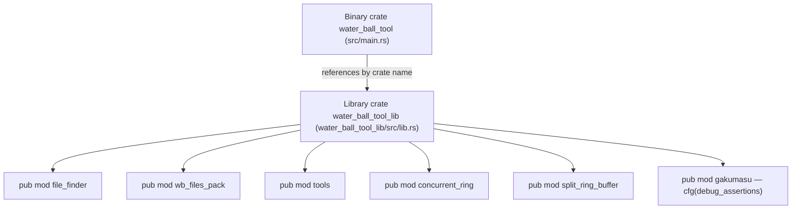
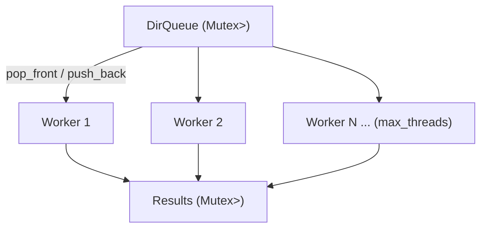
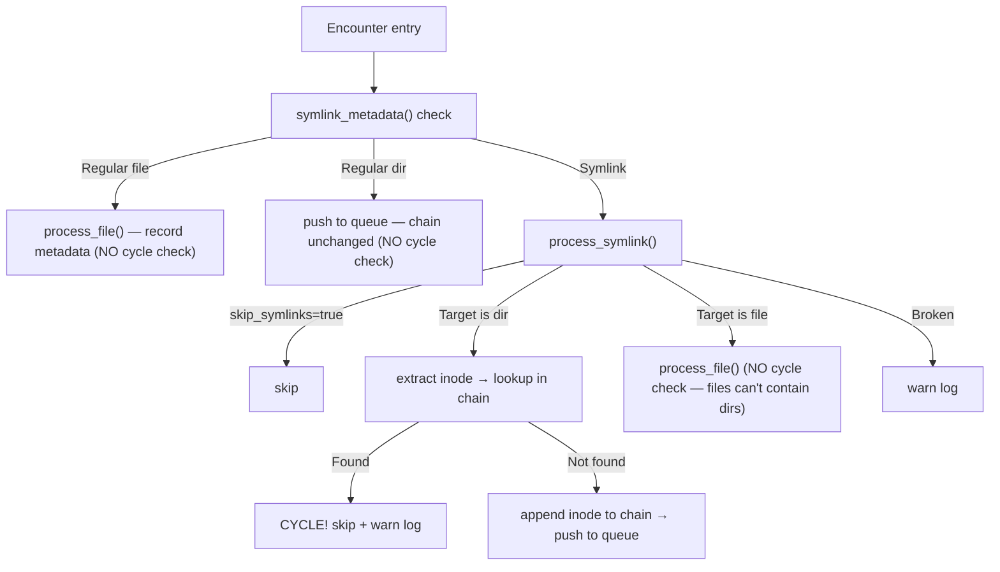
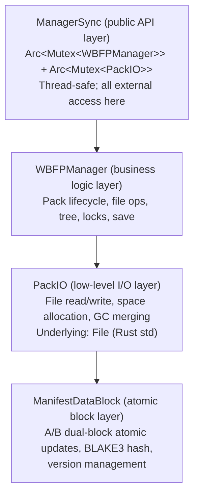
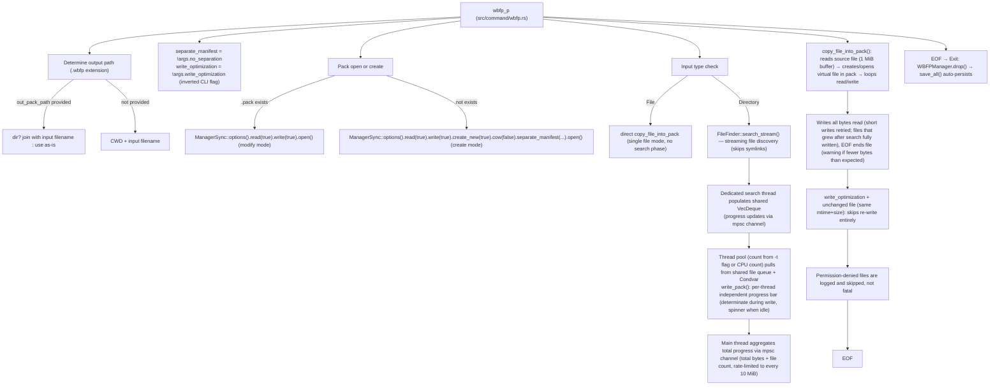
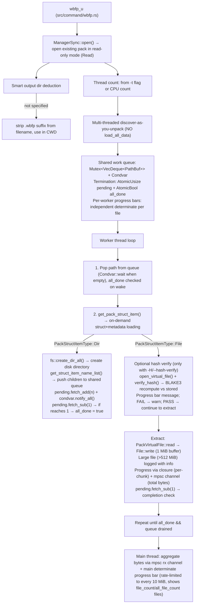
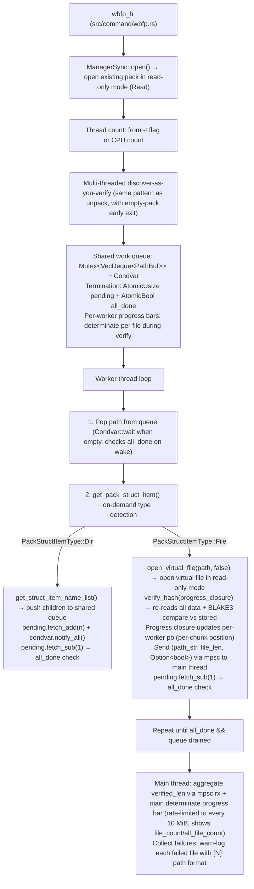
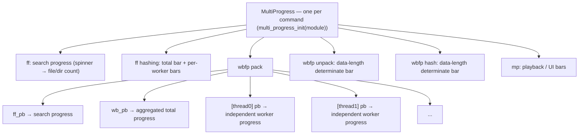
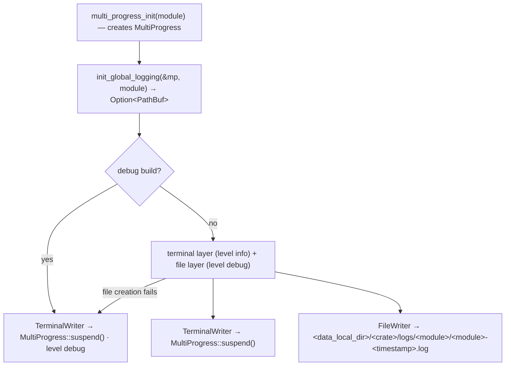

# WaterBall Tool — Architecture

> **Language**: English | [简体中文](docs/zh_CN/ARCHITECTURE.md)

> Last Updated: 2026-10-31

---

## Table of Contents

1. [Overview](#1-overview)
2. [Tech Stack](#2-tech-stack)
3. [Module Dependency Graph](#3-module-dependency-graph)
4. [Workspace: Binary vs Library Crate](#4-workspace-binary-vs-library-crate)
5. [Entry Point & CLI Routing](#5-entry-point--cli-routing)
6. [File Finder (`ff`)](#6-file-finder-ff)
7. [Music Player (`mp`)](#7-music-player-mp)
8. [WaterBall Files Pack (`wbfp`)](#8-waterball-files-pack-wbfp)
9. [Progress Bar System](#9-progress-bar-system)
10. [Logging System](#10-logging-system)
11. [Tools Module](#11-tools-module)
12. [Work-in-Progress Modules](#12-work-in-progress-modules)
13. [Test Architecture](#13-test-architecture)
14. [Design Decisions & Tradeoffs](#14-design-decisions--tradeoffs)

---

## 1. Overview

WaterBall Tool is a multi-purpose CLI toolkit written in **Rust (edition 2024)**. It currently provides three core
features:

- **`ff`** — Multi-threaded parallel file finder, emits a JSON file manifest with symlink cycle detection and optional
  per-file hashing
- **`wbfp`** — Custom binary archive format (WaterBall Files Pack): pack, unpack, and BLAKE3 hash verification
- **`mp`** — Terminal music player: audio playback with playlist modes, stdin controls, and a realtime-safe audio
  thread architecture (`tui/` interface is still WIP)

The repository is a cargo **workspace**: the `water_ball_tool` binary crate (CLI entry, `src/`) depends on the
`water_ball_tool_lib` library crate (`water_ball_tool_lib/src/`), which exposes the reusable modules.


> Portions generated by AI (deepseek-v4-pro), delimited by `//AI===` / `//AI_END===`.

---

## 2. Tech Stack

| Category          | Crate                                                     | Purpose                                                                          |
|-------------------|-----------------------------------------------------------|----------------------------------------------------------------------------------|
| CLI               | `clap 4.6` (derive)                                       | Argument parsing                                                                 |
| Serialization     | `serde` / `serde_json`                                    | Data structures, JSON output                                                     |
| Hashing           | `blake3 1.8`                                              | Pack file data integrity                                                         |
| Hashing (CLI)     | `sha1` / `sha2` / `blake2b_simd` / `md-5` / `crc32fast`   | `ff` per-file hash algorithms                                                    |
| Progress bars     | `indicatif 0.18`                                          | Terminal spinners & progress bars                                                |
| Logging           | `tracing` / `tracing-subscriber`                          | Structured logging (env-filter) + optional log files                             |
| Process detection | `sysinfo 0.39`                                            | PID liveness check for lock files                                                |
| Random            | `rand 0.10`                                               | Randomized test data (longtime tests: random tree search stress, large fixtures) |
| Test utils        | `pretty_assertions 1.4`                                   | Diffable assertion output                                                        |
| Audio             | `cpal 0.18` / `symphonia 0.6` / `rubato 5` / `lofty 0.25` | Audio output, decoding, resampling, tag reading                                  |
| Terminal UI       | `ratatui 0.30`                                            | WIP `mp` TUI                                                                     |
| Thread channels   | `crossbeam-channel 0.5`                                   | Realtime-safe bounded channels (audio callbacks)                                 |

---

## 3. Module Dependency Graph

```
water_ball_tool (binary crate, root package)
  ├── src/main.rs          ← CLI entry; declares `mod command;`
  ├── src/command.rs       ← CLI routing + progress bar helpers
  │   ├── command/ff.rs    ← ff subcommand (search + optional hashing)
  │   ├── command/wbfp.rs  ← wbfp subcommand
  │   ├── command/music_play.rs
  │   │   └── command/music_play/
  │   │       ├── player.rs          ← cpal stream + transport + try_stop
  │   │       ├── decoder_runtime.rs ← symphonia decode thread
  │   │       ├── effect.rs          ← effect traits / audio types
  │   │       │   └── effect/        ← resampler / cross_bridge / fade / runtime
  │   │       ├── play_list.rs       ← tracks + loop/shuffle modes
  │   │       ├── runtime.rs         ← playback orchestration + UI thread
  │   │       ├── event_dispatch.rs  ← realtime event/log dispatch thread
  │   │       ├── tools.rs           ← time metrics / duration accumulators
  │   │       └── tui/               ← terminal UI (WIP)
  │   └── command/test.rs  ← integration tests
  └── depends on:
      water_ball_tool_lib (library crate, workspace member)
        ├── src/file_finder.rs          ← file search core
        │   └── file_finder/test.rs     ← symlink tests
        ├── src/wb_files_pack.rs        ← WBFP module root
        │   ├── data.rs                 ← core data types (1762 lines, largest module)
        │   ├── error.rs                ← error types
        │   ├── manager.rs              ← WBFPManager
        │   │   ├── open.rs             ← create/open pack files
        │   │   ├── save.rs             ← progressive save + throttling
        │   │   ├── file_ops.rs         ← virtual file creation + dir creation
        │   │   ├── tree.rs             ← directory tree traversal + lazy loading
        │   │   ├── metadata.rs         ← file handle creation + metadata update
        │   │   ├── lock.rs             ← process-level write lock
        │   │   ├── gc.rs               ← GC orchestration
        │   │   ├── delete.rs           ← virtual file/dir delete + erase
        │   │   └── test.rs             ← internal API tests
        │   ├── manager_sync.rs         ← public API layer (Arc<Mutex<>>)
        │   │   └── test.rs             ← public API tests
        │   ├── pack_io.rs              ← low-level file I/O + space allocation + GC merging
        │   │   ├── file.rs             ← PackVirtualFile (access mode enforcement)
        │   │   ├── file_handle.rs      ← PackFileHandle (493 lines, core file logic)
        │   │   └── file_hash.rs        ← PackFileHash (BLAKE3 state machine)
        │   ├── net_server.rs           ← network server (WIP, debug builds only)
        │   └── test.rs                 ← module-level tests
        ├── src/tools.rs                ← path utilities + byte formatting + test helpers
        ├── src/concurrent_ring.rs      ← concurrent initializable ring buffer
        ├── src/split_ring_buffer.rs    ← split lock/lock-free read-write ring buffer
        │   └── inner / reader / writer / mode / error / test
        └── src/gakumasu/               ← game simulator (WIP, debug builds only)
            ├── data.rs
            └── simulator.rs
```

---

## 4. Workspace: Binary vs Library Crate

```
Cargo.toml                       → [workspace] resolver = "3", members = ["water_ball_tool_lib"]
                                   + [package] "water_ball_tool" (binary, src/)
water_ball_tool_lib/Cargo.toml   → [package] "water_ball_tool_lib" (library)
```

**Key Rules**

- The root package is the binary crate `water_ball_tool`; `main.rs` declares `mod command;` — `command.rs` is
  **private** to the binary crate.
- The library crate `water_ball_tool_lib` exports: `file_finder`, `wb_files_pack`, `tools`, `concurrent_ring`,
  `split_ring_buffer`, and `gakumasu` (gated under `#[cfg(debug_assertions)]` — only compiled in debug builds).
- Binary code references library code via crate-name-qualified paths — `water_ball_tool_lib::file_finder`,
  `water_ball_tool_lib::wb_files_pack`, `water_ball_tool_lib::tools`, … — **not** `crate::file_finder`.
- Both packages share metadata and dependencies through `[workspace.package]` / `[workspace.dependencies]`.

**Dependency Flow**



---

## 5. Entry Point & CLI Routing

### `main.rs` — Entry Point (344 lines)

```
1. Cli::parse()        — clap derive parses CLI args
2. command::cli(cli)   — routes to the subcommand handler
3. subcommand handler  — calls multi_progress_init(module) to build the MultiProgress and install
                         the global tracing subscriber
4. Err wrapper         — prints the error and exits with code -1
```

Log levels and log-file routing are configured inside `init_global_logging(&mp, module)` — see §10.

### `command.rs` — CLI Routing (100 lines)

```rust
Cli {
    command: Commands::Ff(FileFinderArgs) | Commands::Wbfp(WaterBallFilePackCommand)
           | Commands::MP(music_play::MusicPlayArgs)
}
```

Progress bar helpers

| Function                       | Purpose                                                     |
|--------------------------------|-------------------------------------------------------------|
| `create_pb(mp) -> ProgressBar` | Create and register an auto-ticking spinner (100 ms tick)   |
| `progress_style(template)`     | Build a `ProgressStyle`; invalid template → default + error |

Constants

| Constant                       | Value  | Purpose                                                          |
|--------------------------------|--------|------------------------------------------------------------------|
| `BUF_LEN`                      | 10 MiB | Read/write buffer size                                           |
| `PACK_PROGRESS_STYLE_TEMPLATE` | —      | Pack/unpack/hash bar template (prefix, bar, ETA, percent, bytes) |
| `SPINNER_TEMPLATE`             | —      | Idle/suspended worker spinner template                           |

---

## 6. File Finder (`ff`)

### 6.1 Multi-Threaded Work Queue Model

Architecture: **shared work queue + condition variable** pattern.



**Worker lifecycle**

1. On spawn: `running_count` incremented
2. Loop: `pop_front()` from queue
3. Queue empty: `running_count` decremented, check if zero
    - `running_count == 0` → `condvar.notify_all()`, thread exits
    - Otherwise → `condvar.wait()`, recheck on wake
4. Woken: `running_count` incremented, process popped task

**Progress rate limiting**: fires every 50 files / 10 dirs via `pb.send((delta_files, delta_dirs))`.

**Command-layer thread creation**: the `ff` handler's result-collector, progress-aggregator and hash-worker threads are
created with `thread::Builder::new().name(...).spawn(...)` and spawn failures propagate as errors (the panicking
`std::thread::spawn` is forbidden); taking a worker progress bar that must exist is a logic error and aborts via
`unreachable!`.

### 6.2 Symlink Cycle Detection

Each worker thread maintains an independent **inode chain** (`Vec<InodeKey>`) carried by `DirEntry`:

```rust
struct DirEntry {
    path: PathBuf,
    symlink_chain: Vec<InodeKey>,  // inodes of dirs entered via symlinks on this path
}                                  /
```

**Detection flow**



**Platform differences**

| Platform | InodeKey type | Extraction method                          |
|----------|---------------|--------------------------------------------|
| Unix     | `u128`        | `(dev << 64) \| ino`                       |
| Windows  | `PathBuf`     | `canonicalize()` fallback to original path |

> **Rationale**: Regular directories cannot form cycles in a normal filesystem; only symlinks can close a loop. This
> keeps the detection mechanism scoped exactly where it matters, with zero overhead on normal files and directories.

### 6.3 Core Data Structures

```rust
pub struct FilesList {
    path: String,                            // Root search path
    data_length: u64,                        // Total data size
    file_count: u64,                         // File count (excl. dirs)
    dir_count: u64,                          // Directory count
    files_list: HashMap<String, FileInfo>,   // Direct children of root
}

pub struct FileInfo {
    name: String,           // Name (without path)
    length: u64,            // File=actual size, Dir=cumulative child total
    modified_time: u128,    // ms since UNIX epoch
    file_kind: FileKind,
}

pub enum FileKind {
    File {
        hash: Option<HashMap<String, String>>,  // Per-file hashes (only when [HASH]... is given)
    },
    Dir(Dir),
}

pub struct Dir {
    files_list: HashMap<String, FileInfo>,  // Direct children
    file_count: u64,                        // Cumulative descendant file count
    dir_count: u64,                         // Cumulative descendant dir count
}
```

### 6.4 Streaming Search API

| Feature               | `search()`                  | `search_stream()`                             |
|-----------------------|-----------------------------|-----------------------------------------------|
| `FilesList` tree      | `Some(results)` — full tree | `None` (skips HashMap)                        |
| `HashMap` (in-memory) | Collected                   | None — zero overhead                          |
| Blocking, one-shot    | Yes                         | No — returns `(JoinHandle, Receiver<...>)`    |
| Used by               | `ff` command                | `wbfp` pack, `ff` hashing (producer-consumer) |

### 6.5 Tree Rebuilding

Parallel scan produces a flat `HashMap<PathBuf, FileInfo>`. `build_tree()` reconstructs the nested `FilesList`:

1. Group all entries by parent path → `HashMap<PathBuf, Vec<PathBuf>>`
2. Iterative stack-based post-order build (Pre/Post state machine with explicit `Fr` frames) — avoids stack overflow on
   deeply nested hierarchies; parent-child linkage uses `rposition()` backward search for correct path matching
3. Directory `length` = sum of all descendant file sizes
4. Directory `file_count`/`dir_count` = cumulative across all subdirectories

### 6.6 Hash Computation

- CLI: the optional multi-value positional `[HASH]...` argument (after `[OUT_PATH]`) accepts `all`, `md5`, `sha256`,
  `sha512`, `sha1`, `blake3`, `blake2b`, `crc32` (aliases `*`, `m5`, `s256`, `s512`, `s1`, `b3`, `b2b`, `crc`).
- Implementation (`command/ff.rs`): `HashTypeS` holds one hasher per selected algorithm and exposes `update`, `reset`,
  and `finalize_reset_str_map` (hex strings), so multiple algorithms share a single read pass.
- `search_stream()` is called with `ff_thread_count = 1` when hashing is enabled; discovered file entries are pushed
  into a `ConcurrentRing`, and `thread_count` hash workers (from `-t/--thread-count` or available parallelism) pop
  entries, read each file with a 10 MiB buffer, compute the hashes, and insert a new `FileInfo` with
  `FileKind::File { hash: Some(map) }` into the result map.
- The main thread aggregates per-worker progress over an mpsc channel (rate-limited to every 10 MiB).
- Selecting MD5/SHA-1 logs an insecurity warning. Every code path (open failure, read failure, EOF mismatch, channel
  disconnect) resets the hashers so the next file starts clean.

---

## 7. Music Player (`mp`)

**Files**: `src/command/music_play.rs` + `src/command/music_play/*.rs` (~4,900 lines total)

### 7.1 Overview

`mp` is a terminal music player. The command:

1. Collects tracks from the positional `files...` paths (directories are walked recursively); tags and duration come
   from `lofty`, and tracks whose metadata cannot be read are logged and skipped.
2. Builds a `PlayList` with the selected loop mode and creates a `Runtime`.
3. Starts playback and then reads commands from stdin until `exit`: `next`/`n`, `Play`/`P`, `pause`/`p`, `exit`.

CLI arguments (`MusicPlayArgs`):

| Argument             | Default           | Purpose                                                                                 |
|----------------------|-------------------|-----------------------------------------------------------------------------------------|
| `files...`           | —                 | Audio files and/or directories to play                                                  |
| `-v, --volume <f32>` | `0.75`            | Initial volume, 0.0–1.0 (values outside this range are rejected with an argument error) |
| `--verbose`          | off               | Verbose output (long option only)                                                       |
| `-m, --mode <MODE>`  | `sequential-loop` | `sequential-loop`, `sequential`, `repeat-one`, `shuffle`, `periodic-shuffle`            |

### 7.2 Modules

| Module                   | Responsibility                                                                                                                  |
|--------------------------|---------------------------------------------------------------------------------------------------------------------------------|
| `player.rs`              | cpal output stream, `PlayCmd` transport, volume/position atomics, event sinks, `Player::try_stop`                               |
| `decoder_runtime.rs`     | symphonia decode thread: probes/seeks the file, decodes audio into the pre-effect ring buffer; owns the paired `DecoderSession` |
| `effect.rs`              | `PostEffect`/`PreEffect` traits, `AudioFormat`, `PlayCmd`, effect chain                                                         |
| `effect/runtime.rs`      | Locked pre-effect runtime thread (event sinks, stop/reject handling)                                                            |
| `effect/resampler.rs`    | rubato FFT resampler to the output device sample rate                                                                           |
| `effect/cross_bridge.rs` | Crossfade bridging between tracks                                                                                               |
| `effect/fade.rs`         | Fade in/out and pause/resume transport handling                                                                                 |
| `play_list.rs`           | `Track` list, loop modes, shuffle queues, next-track selection                                                                  |
| `runtime.rs`             | Orchestration: track advance on `TrackEnded`, UI refresh thread, event consumers, stop                                          |
| `event_dispatch.rs`      | Dedicated dispatch thread for realtime-callback events and logs                                                                 |
| `tools.rs`               | `TimeMetrics` / `DurationAccumulator` profiling counters                                                                        |
| `tui/`                   | Terminal UI (`app.rs`, `ui.rs`, `channel_writer.rs`) — **WIP, not wired into the command**                                      |

### 7.3 Realtime Audio Thread

Data flows from the decode thread → pre-effect ring buffer → pre-effect runtime → split ring buffer (lock-free read
side) → cpal callback → device.

The cpal callback runs in a realtime context and therefore:

- never takes a blocking lock (it uses `try_lock` on the effect chain and the split ring buffer's lock-free reader),
- never invokes `PlayerEventSink` directly,
- never writes logs.

Instead it posts events (`TrackEnded`) and log records with non-blocking `try_send` into the `EventDispatcher`'s
bounded channel (`DISPATCH_CHANNEL_CAPACITY = 1024`). A full channel drops the message and increments the dropped
counter (reported at debug level on stop).

The `player-event-dispatch` thread performs the real work: locking the sink list, invoking `PlayerEventSink::emit`, and
emitting `tracing` events (including stream errors) through the normal logging pipeline.

Transport commands (`PlayCmd::{Play, Pause, Seek, ClearEofBuf}`) travel from the command side to the callback over a
bounded crossbeam channel; accepted commands are reported back on an unbounded channel to the `rx_cmd` thread, which
drives `stream.play()` / `stream.pause()`.

### 7.4 Decoder Runtime & Error Propagation

- The decoder keeps its symphonia engine (format reader + decoder) and its data (track metadata) together in one
  `DecoderSession` stored in a single `Arc<Mutex<Option<DecoderSession>>>`. Track changes replace or take the whole
  session under that one lock, so an "engine present but data missing" state cannot occur. The old split
  `engine`/`data` `Option` pair and its missing-data branch are gone.
- `DecoderRuntime::run()` and `PreEffectRuntime::run()` return `Result`; a failed thread spawn aborts `Player::new()`
  with an error instead of being logged and ignored.
- Decode-loop error policy:
    - real runtime failures — `next_packet` error, a genuine ring-buffer write failure, a failed EOF push, or a fatal
      (non-frame-level) decode error — emit a `DecoderEvent` error and stop the decode thread;
    - a single-frame `DecodeError` is recoverable: it is reported and the frame is skipped;
    - `WriteRejected` during stop, track change, or seek is normal control flow, not an error.
- `DecoderRuntime::stop()` records a `send_skip` failure, always joins the decode thread, then returns the first error;
  `Player::try_stop` logs stop failures and continues the remaining shutdown steps.
- Event-channel sink constructors (`PlayerEventChannelSink::new`, `DecoderEventChannelSink::new`,
  `PreEffectRuntimeEventChannelSink::new`) return `std::io::Result`; direct sinks construct infallibly. `Player::new()`
  and `Runtime::create()` propagate sink and thread spawn failures.

### 7.5 Shutdown (`Player::try_stop`)

`try_stop()` is idempotent and reclaims every thread in a fixed order:

1. Pause the audio stream and clear `is_playing`, so no new events are produced.
2. Stop the pre-effect runtime — its `reject_waiting_writers` wakes producers blocked in `push_wait`, preventing a join
   deadlock.
3. Stop the decoder thread.
4. Stop the event dispatch thread (`Stop` message + join).
5. Join the `rx_cmd` thread via the handle stored in the player.

Failures at any step are logged, not propagated; `Runtime::run_stop` additionally joins the UI thread.

---

## 8. WaterBall Files Pack (`wbfp`)

**Files**: `water_ball_tool_lib/src/wb_files_pack/*.rs` (~6,000+ lines total)

### 8.1 Overall Architecture

WBFP uses a **three-layer architecture**



### 8.2 Binary Format

Full specification at `docs/en_US/wb_files_pack/manifest-data.md`. Summary:

```
.pack file layout
┌────────────────────────────────────────────────────────┐
│  FILE_HEADER_BLOCK_LEN (128 + attribute block)         │
│  ├─ File header: magic "WBFilesPack", ver [0,2]        │
│  │   ├─ type_name (11B)                                │
│  │   ├─ version (2B)                                   │
│  │   ├─ bool_data (1B) — cow bit[0], s_manifest bit[1] │
│  │   ├─ pack_len (8B)                                  │
│  │   └─ padding to 128B                                │
│  └─ Embedded Attribute manifest data block             │
├────────────────────────────────────────────────────────┤
│  Data Region                                           │
│  ├─ File data blocks (DATA_DATA_BLOCK_LEN-aligned)     │
│  └─ (optional) manifest data (when !separate_manifest) │
├────────────────────────────────────────────────────────┤
│  Manifest Index                                        │
│  ├─ DataPosList (data free region list)                │
│  ├─ DataPosList (manifest free list, separated only)   │
│  ├─ PackStruct (root directory)                        │
│  │   └─ PackStructItem ... (recursive)                 │
│  └─ PackFileMetadata ... (per file/dir)                │
└────────────────────────────────────────────────────────┘
```

**Key Constants**

| Constant                      | Value | Purpose                         |
|-------------------------------|-------|---------------------------------|
| `DATA_BLOCK_LEN`              | 128 B | Manifest data alignment unit    |
| `DATA_DATA_BLOCK_LEN`         | 4 MiB | File data allocation unit       |
| `MANIFEST_VERSION`            | 10    | Current manifest format version |
| `MANIFEST_VERSION_COMPATIBLE` | 10    | Minimum compatible version      |

### 8.3 Core Data Structures

```rust
/// Top-level manifest
pub struct WBFilesPackManifest {
    attribute: Attribute,         // Global attributes (always resident)
    root_struct: PackStruct,      // Root directory structure
    file: Option<PackIO>,         // Manifest file I/O (separated mode)
}

/// Global attributes — pack file metadata
pub struct Attribute {
    version: u16,                              // Format version
    version_compatible: u16,                   // Compatible version
    cow: bool,                                 // Copy-on-write
    empty_data_pos_list_pos: u64,              // Data free-list position
    manifest_empty_data_pos_list_pos: u64,     // Manifest free-list position
    manifest_file_len: u64,                    // Manifest file length
    root_struct_pos: u64,                      // Root struct position
    file_count: u64,                           // Total files
    dir_count: u64,                            // Total dirs
    data_len: u64,                             // Total data size
    data_block: ManifestDataBlock,
    dirty: bool,                               // Dirty flag
}

/// Directory structure node
pub struct PackStruct {
    items: HashMap<String, PackStructItem>,    // Children
    data_block: ManifestDataBlock,
    dirty: bool,
}

/// Directory entry
pub struct PackStructItem {
    name: String,
    metadata_file_pos: u64,                    // Metadata position
    item_type: PackStructItemType,
    metadata: PackFileMetadataRun,             // State machine
}

pub enum PackStructItemType {
    File { handle: Option<Weak<Mutex<PackFileHandle>>> },
    Dir { struct_file_pos: u64, pack_struct: Option<PackStruct> },
}

/// Metadata state machine — controls access lifecycle
pub enum PackFileMetadataRun {
    None,                                       // No metadata
    NoLoad,                                     // Not yet loaded
    Loaded(Box<PackFileMetadata>),              // Ready for use
    Locked,                                     // Write in progress
}

pub enum PackFileMetadataType {
    File {
        hash_type: u8,                          // 1 = BLAKE3
        hash_value: Vec<u8>,                    // Hash value
        data_pos_list: DataPosList,             // Allocated block positions
    },
    Dir {
        file_count: u64,                        // Cumulative child file count
        dir_count: u64,                         // Cumulative child dir count
    },
}

/// Dual-purpose position list
///   PackIO.empty_data_list  → tracks FREE (reusable) regions
///   PackFileMetadata.data_pos_list → tracks ALLOCATED blocks
pub struct DataPosList {
    data_block: Option<ManifestDataBlock>,
    list: Vec<(u64, u64)>,                      // (position, length) pairs / (
}
```

### 8.4 Manifest Data Block — A/B Dual-Block Mechanism

**File**: `water_ball_tool_lib/src/wb_files_pack/data.rs` (1762 lines — the largest single module)

All index data (Attribute, PackStruct, PackFileMetadata, DataPosList) is stored in `ManifestDataBlock` instances.

**A/B block structure**

```
┌──────── A Block ────────┬──────── B Block ────────     ┐
│ len(8) │ ver(4) │ hash(8) │ data(...) │ ver(4) │ ...   │
└─────────────────────────┴─────────────────────────     ┘
──────────────────────────────────────────────────────────
        Entire block = aligned to multiples of DATA_BLOCK_LEN (128B)
```

**Atomic update flow**

1. Read both half-blocks, extract version numbers from each
2. Write to the half-block with the **lower** version (`ver + 1`)
3. The other half-block remains untouched
4. Crash after partial write → at least one complete version survives

**Read flow**

1. Check A-block head-tail version match (fast integrity check)
2. Check B-block the same way
3. Pick the half with the higher version that passes validation

**Block size calculation**

```
block_len = ceil((24 + data_len) × 2 / DATA_BLOCK_LEN) × DATA_BLOCK_LEN
```

**Version wrapping**

```rust
fn next_ver(ver: u32) -> u32 {
    if ver == u32::MAX { 1 } else { ver + 1 }
}

// Uses wrapping subtraction to correctly handle u32 rollover
fn ver_is_older(a: u32, b: u32) -> bool {
    a != b && b.wrapping_sub(a) < a.wrapping_sub(b)
}
```

### 8.5 Space Allocation & Garbage Collection

**Core file**: `water_ball_tool_lib/src/wb_files_pack/pack_io.rs` (402 lines) — PackIO layer

**Space allocation `get_file_pos(length)`**

```
1. Align length to DATA_BLOCK_LEN (128B) boundary
2. Try free list first (empty_data_list):
   └─ Exact match → remove from list, return
   └─ Larger than needed → split: allocate front, keep remainder
3. No suitable free block → extend file: return (file.len, length)
```

**Data allocation**
Pass 1
`get_pos_contiguous`
`MAX_DATA_SEGMENTS`(16)

- Known size (`alloc_size(Some(len))`, e.g. length known from search) allocates
  exactly at 128B alignment via `get_file_pos`, matching the pack's global
  alignment rule with no waste. Unknown size (`alloc_size(None)`, default)
  allocates via 4MiB-aligned `get_data_file_pos_multi` (initial `create_file_raw`)
  reusing free fragments first: Pass 1 single-block first-fit (`get_pos_gc`) →
  Pass 2 contiguous chain of physically adjacent fragments (`get_pos_contiguous`)
  → Pass 3 largest-first accumulation (`get_pos_biggest`); the `empty_data_list`
  order is never changed; extend-file fallback when fragments are insufficient.
  Segments are counted against the virtual file's data segment list (`data_pos_list` existing + new), capped at
  `MAX_DATA_SEGMENTS` (16); over-limit
  allocations are rejected with an error (no partial writes). Fragments are
  batch-sorted and merged into `empty_data_list` by `file_gc` (during `save_all`)
  before they participate in reuse. `alloc_size` is ignored when opening an
  existing file (never shrinks an existing allocation). Manifest data always
  uses 128B-aligned `get_file_pos`.

**Garbage collection**

```
Stage 1 — Staging (file_gc_add):
   ├─ PackFileHandle drops → manager → file_gc_add buffers into gc_data_pos_list

Stage 2 — Merging (file_gc):
   ├─ Append staging items to empty_data_list, then batch sort_unstable_by_key(pos)
   │  O((K+M) log(K+M))
   │  batch sort replaces the previous insertion sort
   ├─ Single-pass merge adjacent: pos1 + len1 == pos2 → merge into one block
   └─ Write updated empty data list
```

**GC trigger points**

- `WBFPManager.save_all()` → `file_gc()` + `manifest_file_gc()`
- File resize-down or overwrite → `PackFileHandle::commit_data()` on drop

### 8.6 Progressive Save

**File**: `water_ball_tool_lib/src/wb_files_pack/manager/save.rs` (200 lines)

**Throttling condition `throttled_save()`**

```rust
// Trigger save_all() when:
if all_write_len - last_all_write_len > 64 * 1024 * 1024  // 64MiB written
   || all_cr_file_count - last_all_cr_file_count > 10_000  // or 10K files added
```

**`save_all()` flow**

1. `file_gc()` — data region garbage collection
2. `manifest_file_gc()` — manifest file garbage collection
3. `save_root_pack_struct()` — persist root struct (dirty-checked)
    - Also calls `save_manifest_attribute()` if dirty
4. `save_pack_length()` — update pack_len in file header

**Dirty flag chain**

`save_all()` (visibility: `pub(crate)`) is also invoked in `WBFPManager.drop()` — data is always persisted on process
exit (unless panicking).

### 8.7 Process-Level Write Lock

**File**: `water_ball_tool_lib/src/wb_files_pack/manager/lock.rs` (134 lines)

```
Flow
1. Create .lock file, write current PID as little-endian u32
2. sync_all() — ensure persistence
3. File::lock() — acquire OS-level exclusive lock
4. On process exit (Drop): file.unlock() + delete .lock file
```

**Lock detection `write_lock_info()`**

- Read PID from `.lock` file
- `sysinfo::System::new_all()` → check if PID is alive
- PID not alive → panic with message suggesting manual lock file removal
- `.lock` is a directory or symlink → error (abnormal state)

### 8.8 Public API Layer — ManagerSync

| **File**: `water_ball_tool_lib/src/wb_files_pack/manager_sync.rs` (438 lines)

`ManagerSync` is the thread-safe wrapper around `WBFPManager` + `PackIO`:

```rust
#[derive(Clone)]
pub struct ManagerSync {
    access_mode: PackAccessMode,  // Enforces read/write/read-write at open time
    manager: Arc<Mutex<WBFPManager>>,
    pack_io: Arc<Mutex<PackIO>>,
}
```

**Public API surface**

| Category        | Methods                                                                          | Purpose                                                                                  |
|-----------------|----------------------------------------------------------------------------------|------------------------------------------------------------------------------------------|
| **Open/Create** | `open(path)`                                                                     | Read-only open existing pack                                                             |
|                 | `create_new(path)`                                                               | Create new pack (defaults from PackOpenOptions), fail if exists                          |
|                 | `options() -> PackOpenOptions`                                                   | Full builder: `read()`/`write()`/`create()`/`create_new()`/`cow()`/`separate_manifest()` |
| **Virtual**     | `open_virtual_file(path, end_pos)`                                               | Read-only open existing virtual file                                                     |
|                 | `create_virtual_file(path)`                                                      | Write-only create new virtual file                                                       |
|                 | `virtual_file_options() -> VirtualFileOpenOptions`                               | Builder: `read()`/`write()`/`create_new()`/`end_pos()`/`alloc_size()`                    |
| **Read**        | `get_manifest_attribute` / `get_root_struct_items` / `get_dir` / `load_all_data` |                                                                                          |
| **Write**       | `create_dir_all` / `delete_file` / `delete_dir_all`                              |                                                                                          |
| **Delete**      | `delete_file` / `delete_dir_all`                                                 | Remove metadata + structure, GC data blocks (no overwrite)                               |
| **Erase**       | `erase_file(strategy)` / `erase_dir_all(strategy)`                               | Overwrite data + manifest blocks → GC → remove                                           |
| **Verify**      | `verify_all_file_hash`                                                           | Recursively hash-verify all files                                                        |

**Overwrite strategies**

| Strategy  | Passes | Description                                                     |
|-----------|--------|-----------------------------------------------------------------|
| `Zero`    | 1      | Single pass of 0x00                                             |
| `Random`  | 1      | Single pass of random bytes                                     |
| `Dod5220` | 3      | DoD 5220.22-M: 0x00 → 0xFF → random (each pass written to disk) |

> `child_locked_count` on `PackStruct` tracks how many descendant files have active write handles. A directory can only
> be deleted/erased when `child_locked_count == 0`.

**Design notes**

- `Arc<Mutex<>>` for thread safety — multiple `PackVirtualFile` instances can operate concurrently
- Every method acquires the manager lock → serialized access
- `ManagerSync` is `Clone` — multiple holders share the same pack reference

### 8.9 Virtual File I/O — PackVirtualFile + PackFileHandle

**PackVirtualFile** (`pack_io/file.rs`, 210+ lines) — renamed from `PackFileWR`:

- Implements `Read + Write + Seek` traits with **access mode enforcement**
- Holds `Arc<Mutex<PackFileHandle>>`
- Tracks `pos` (current read/write position) + `AccessMode` (Read/Write/ReadWrite)
- All operations delegated to `PackFileHandle`
- Opened via `VirtualFileOpenOptions` builder pattern (std::fs::File-compatible)
- `get_len()` returns `u64` (not `Result<u64>`); `get_modified()` returns `u128` (not `Result<u128>`) — internal lock
  acquisition no longer produces a recoverable error
- Mutex poison recovery uses `std::sync::PoisonError::into_inner` throughout

**PackFileHandle** (`pack_io/file_handle.rs`, 493 lines — the most complex single file

```
Responsibilities
    1. Virtual file position management (sparse file support)
    2. Allocation: DataPosList-managed (position, length) list
    3. set_len: grow → auto-allocate new blocks; shrink → release excess → GC
    4. write: map virtual position → real file offset → pack_io.write
    5. read:  map virtual position → real file offset → pack_io.read
    6. commit_data (Drop): compute hash → write back metadata → release pre-allocated space

```

**Position mapping cache**: `temp_pos_index` + `temp_pos_this_len` avoids traversing the entire DataPosList on every
read/write.

**Drop behavior**: `PackFileHandle.drop()` auto-invokes `commit_data()`:

1. Compute and persist file hash
2. Release pre-allocated but unused space (via `set_len(metadata_len)`)
3. Return metadata to `WBFPManager.file_metadata_update()`

### 8.10 Hash System

**File**: `water_ball_tool_lib/src/wb_files_pack/pack_io/file_hash.rs` (81 lines)

```rust
enum PackFileHash {
    None,
    Blake3 { hasher: Box<Hasher>, hash_value: Vec<u8> },
}
```

- Type 0: `None` (directory type)
- Type 1: `Blake3` (file type)
- `update()` — incremental hash update
- `get_hash_value()` — finalize hash
- `eq()` — compare with stored hash value

**Hash verification triggers**

- Pack/write: `PackFileHandle.commit_data()` → `read_hash_v()` recomputes on close
- Unpack/read: `PackVirtualFile::verify_hash()` optional pre-read check
- CLI: `wbfp h` command traverses all files; `ff` computes selected hashes while scanning (see §6.6)

### 8.11 Error Types

**File**: `water_ball_tool_lib/src/wb_files_pack/error.rs` (67 lines)

```rust
pub enum PackFileError {
    Io(std::io::Error),
    Lock(String),
    Integrity(String),
    Format(String),
    NotFound(String),
    NotADirectory(String),
    PermissionDenied(String),
    Version(String),
    State(String),
    Other(String),
}
```

- `From<std::io::Error>` → enables `?` operator
- `From<PackFileError> for std::io::Error` → enables Read/Write/Seek trait impls
- Bilingual `Display` messages (Chinese + English) using inline format variables `{e}`, `{msg}` — no redundant `format!`
  calls

### 8.12 Pack Flow



### 8.13 Unpack Flow



### 8.14 Hash Verify Flow



---

### 8.15 Worker Threads & Error Policy

- Pack/unpack/hash-verify worker threads and the pack search/copy helper threads are created with
  `thread::Builder::new().name(...).spawn(...)`; a spawn failure is propagated (`PackFileError` / `io::Error`) instead
  of panicking (`std::thread::spawn` panics when the OS cannot create a thread).
- Exhausting the per-worker progress-bar pool is an invariant violation and aborts via `unreachable!`.
- In `manager/file_ops.rs`, `manager/metadata.rs`, and `pack_io/file_handle.rs`, invariant violations (missing metadata
  while a handle exists, non-file metadata reached through a file handle, …) abort via `unreachable!`.
- Genuine runtime failures are returned, never converted into `unreachable!`: for example
  `open_virtual_file`/`create_virtual_file` receiving a directory path returns `PackFileError`, and spawn/I/O failures
  propagate as errors.

---

## 9. Progress Bar System

**Core design**: every subcommand creates its own `indicatif::MultiProgress` via `multi_progress_init(module)`; all
child
bars of that command are registered in it. The terminal log writer wraps the same `MultiProgress`, so `suspend()` keeps
log lines from tearing the bars.

**Hierarchy**



**Progress bar modes**

| Mode         | Template                                 | Use case                      |
|--------------|------------------------------------------|-------------------------------|
| Spinner      | `SPINNER_TEMPLATE`                       | Unknown totals / idle workers |
| Determinate  | `PACK_PROGRESS_STYLE_TEMPLATE` (`=>-`)   | Known-total pack, unpack      |
| Determinate+ | `PACK_PROGRESS_STYLE_TEMPLATE` (percent) | Hash verify, `ff` hashing     |

**Rate limiting**: progress updates are throttled to every 10 MiB processed (10×`BUF_LEN`) to avoid excessive UI
refresh; the file finder additionally reports every 50 files / 10 dirs.


---

## 10. Logging System

**File**: `src/main.rs` — `multi_progress_init` / `init_global_logging`



**Key design**:

- `TerminalWriter` buffers output per line and prints it through `MultiProgress::suspend()`, so log output never
  corrupts the progress bars; mutex poisoning is recovered with `PoisonError::into_inner`.
- `FileWriter` (release builds only) uses a bracketed format:
  `[UTC timestamp] [level] [thread name/id] [file:line] message`, with `ansi(false)`.
- Debug builds (`#[cfg(debug_assertions)]`) log to the terminal only at `debug` level. Release builds log to the
  terminal
  at `info` level and to the log file at `debug` level.
- Log file path: `<ProjectDirs data_local_dir>/<crate>/logs/<module>/<module>-<YYYY-MM-DD_HH-MM-SS>.log` (module names
  sanitized). If the file cannot be created, logging falls back to terminal-only `debug` output.


---

## 11. Tools Module

**File**: `water_ball_tool_lib/src/tools.rs` (199 lines)

| Function/Type                      | Purpose                                                           |
|------------------------------------|-------------------------------------------------------------------|
| `PathTool::path_to_string_vec`     | Split path into string segments, excluding root separator         |
| `PathTool::path_remove_head`       | Strip head prefix from path to get relative path                  |
| `bytes_len_to_string(len)`         | Format byte count as B / KiB / MiB / GiB (2 decimal places)       |
| `TestTool::prepare_test_dir`       | Remove stale test temp dir (tolerates `NotFound`) and recreate it |
| `TestTool::cleanup_test_dir`       | Remove the test temp dir at test end; panics on cleanup errors    |
| `TestTool::remove_test_pack_files` | Clean up `.pack`, `.wbm`, `.lock` files after tests               |
| `TestTool::expect_ok`              | Non-panicking `unwrap` replacement for tests                      |

---

## 12. Work-in-Progress Modules

### gakumasu (Game Simulator

**Files**: `water_ball_tool_lib/src/gakumasu/data.rs` (116 lines), `water_ball_tool_lib/src/gakumasu/simulator.rs`
(10 lines)

- Gated behind `#[cfg(debug_assertions)]` — only compiled in debug builds
- Not wired into CLI
- Defines card system types (skill cards, field effect cards), attribute system, effect conditions
- Chinese naming conventions (Gakuen Idolmaster Japanese terminology)
- `simulator.rs` has an empty `GameSimulator` struct and `GameRunning` runtime state

### net_server (Network Server

**File**: `water_ball_tool_lib/src/wb_files_pack/net_server.rs` (27 lines)

- Gated behind `#[cfg(debug_assertions)]` — only compiled in debug builds
- `WBFPServer` skeleton: manages `HashMap<String, ManagerSync>` for multiple packs
- `WBFPServerClient` skeleton: single client connection
- No network listener logic yet

### tui (Music Player Terminal UI)

**Files**: `src/command/music_play/tui/` (`app.rs`, `ui.rs`, `channel_writer.rs`)

- WIP and **not wired into** the `mp` command yet (the command currently uses stdin commands + progress bars)
- `App` buffers up to 1,000 log lines for display; `ui.rs` / `channel_writer.rs` are the rendering side

---

## 13. Test Architecture

| File                                                    | Type         | Coverage                                                                                                                    |
|---------------------------------------------------------|--------------|-----------------------------------------------------------------------------------------------------------------------------|
| `src/command/test.rs`                                   | Integration  | ff + wbfp commands, cross-platform symlink cycle detection, synthetic fixture longtime tests (1000 random files via `rand`) |
| `water_ball_tool_lib/src/file_finder/test.rs`           | Unit         | Symlink discovery, ancestor cycles, multi-level, broken, mixed, chain propagation, search_stream                            |
| `water_ball_tool_lib/src/concurrent_ring/test.rs`       | Unit         | Ring buffer push/pop, capacity, wait/reject paths                                                                           |
| `water_ball_tool_lib/src/split_ring_buffer/test/`       | Unit         | Basic/blocking/non-copy/drain-release/reject scenarios                                                                      |
| `water_ball_tool_lib/src/wb_files_pack/test.rs`         | Module       | Pack file create, read/write, verify                                                                                        |
| `water_ball_tool_lib/src/wb_files_pack/manager/test.rs` | Internal API | Manager internal logic                                                                                                      |
| `.../wb_files_pack/manager_sync/test.rs`                | Public API   | Delete + erase (11 tests), file create/rw/reopen, cow, hash verify, threaded access                                         |
| `src/command/music_play/effect/test.rs`                 | Unit         | Effect chain / resampler / fade behavior                                                                                    |
| `src/command/music_play/event_dispatch/test.rs`         | Unit         | Event dispatch thread, drop counting, stop semantics                                                                        |

**Testing conventions**

- Slow tests marked `#[ignore = "longtime"]`, skipped via `cargo test` (
- Test temp dir: `./temp/test/` (gitignored)
- Subcommand entries call `multi_progress_init(module)` themselves, so tests that invoke `ff::args` / `wbfp::commands` /
  `music_play::args` get logging initialized without extra setup
- `TestTool::remove_test_pack_files(path)` for pack file test cleanup
- Cross-platform tests use `#[cfg(unix)]` / `#[cfg(windows)]` for compilation gating

---

## 14. Design Decisions & Tradeoffs

### File Finder

| Decision                                | Rationale                                                                                 |
|-----------------------------------------|-------------------------------------------------------------------------------------------|
| Per-thread inode chain (not global map) | Simpler, lock-free; cycles are rare and usually on a single path                          |
| Flat HashMap + post-scan tree rebuild   | More efficient than maintaining nested tree during scanning                               |
| No cycle check on regular files/dirs    | Filesystem cannot form cycles with normal directories; detection only needed for symlinks |
| Windows uses PathBuf as InodeKey        | Cannot reliably get (dev, ino) on Windows; canonicalize as best approximation             |

### WBFP

| Decision                              | Rationale                                                                                                          |
|---------------------------------------|--------------------------------------------------------------------------------------------------------------------|
| A/B dual-block instead of WAL         | Simpler implementation; no separate log file or replay logic                                                       |
| BLAKE3 truncated to 8 bytes           | Storage-constrained; collision probability negligible at 8 bytes                                                   |
| PackIO implements both Read+Write     | Centralized I/O; easy separated/embedded mode switching                                                            |
| Separate manifest on by default       | Core pack file needs no modification, reducing corruption risk                                                     |
| Lazy directory structure loading      | Avoids parsing entire pack on open; load-on-demand                                                                 |
| Progressive (throttled) save          | Prevents data loss from power failure during long pack ops                                                         |
| PID lock file + sysinfo               | More reliable than pure file locks; detects stale locks                                                            |
| `Arc<Mutex<>>` instead of Actor model | Simpler implementation; direct state sharing, no message passing                                                   |
| PackFileHandle commits on Drop        | Guarantees persistence even if caller forgets to close                                                             |
| `child_locked_count` per PackStruct   | Directory safety: inc on file handle creation, dec on unlock; delete/erase blocked when > 0                        |
| Delete vs Erase as separate APIs      | Delete is fast (metadata-only I/O, GC data without overwrite); Erase overwrites every byte on disk before removal  |
| DoD 5220 writes each pass to disk     | All three passes (0x00, 0xFF, random) perform independent disk writes — not just in-memory buffer churn            |
| Erase offsets advance per chunk       | Multi-block data overwrite seeks to `pos + write_len` on every pass; otherwise only the first chunk is overwritten |

### Music Player

| Decision                                 | Rationale                                                                                            |
|------------------------------------------|------------------------------------------------------------------------------------------------------|
| Realtime callback posts, never emits     | No locking / sink calls / logging on the audio thread — avoids jitter, priority inversion, underruns |
| Bounded dispatch channel (1024)          | `try_send` never blocks the realtime thread; overflow is counted and reported instead of stalling    |
| Dedicated `player-event-dispatch` thread | All sink locking/emission and tracing output happen outside the audio callback                       |
| Split ring buffer for audio data         | Lock-free read side for the callback; writer side stays locked for the producer                      |
| Fixed stop order in `try_stop`           | Pausing the stream first, then pre-effect → decoder → dispatcher → `rx_cmd`, prevents join deadlocks |
| Single `DecoderSession` lock             | Engine + metadata are swapped/taken as a pair; an unpaired state cannot occur                        |
| `run()` returns spawn errors             | Player initialization aborts on thread-spawn failure instead of running without that thread          |
| Logic errors use `unreachable!`          | Runtime failures are returned/reported; only broken invariants abort                                 |
| `debug-no-audio` feature                 | Lets playback-control logic be debugged without audio hardware or real sample flow                   |

### Overall

| Decision                                 | Rationale                                                                             |
|------------------------------------------|---------------------------------------------------------------------------------------|
| Workspace (binary + library crate)       | Library logic in `water_ball_tool_lib`; CLI-only code in the root binary package      |
| Thread creation via `thread::Builder`    | Command-layer spawn failures are returned as errors; `std::thread::spawn` would panic |
| Logic errors abort via `unreachable!`    | Broken invariants abort; genuine runtime failures are returned or reported            |
| Crate-name-qualified paths in command.rs | `command.rs` is in binary crate, not the library                                      |
| `PackFileError` impls `From` both ways   | Enables `?` operator + Read/Write/Seek trait impls                                    |
| Bilingual comments throughout            | Chinese developer, English code; comments in both languages                           |
