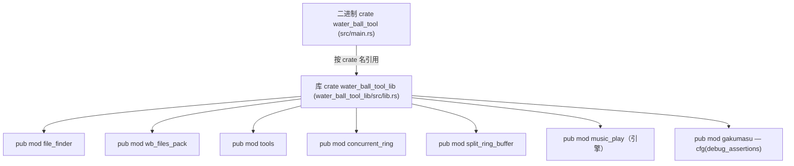
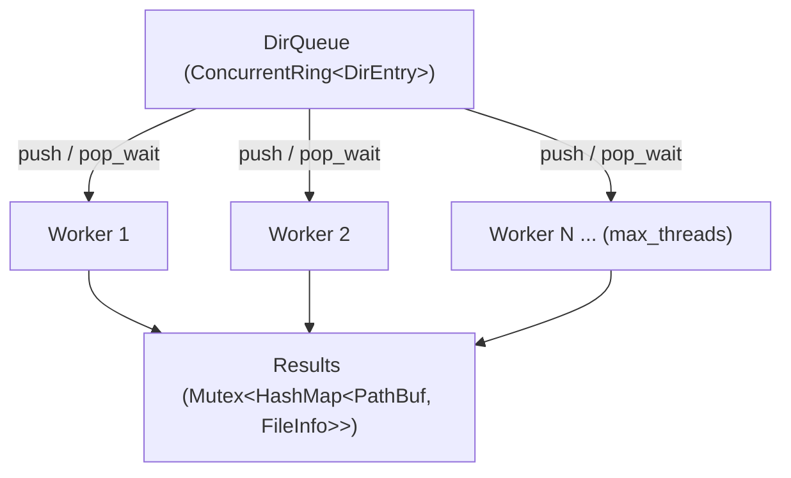
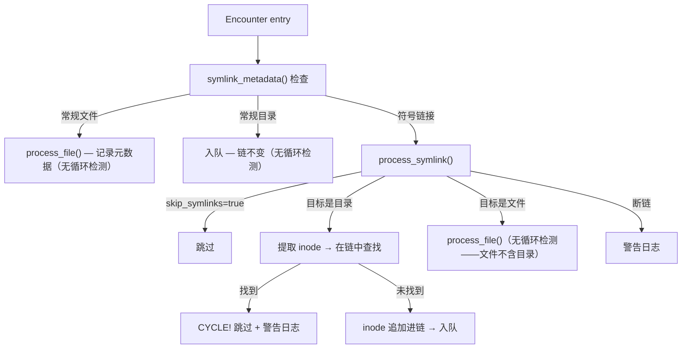
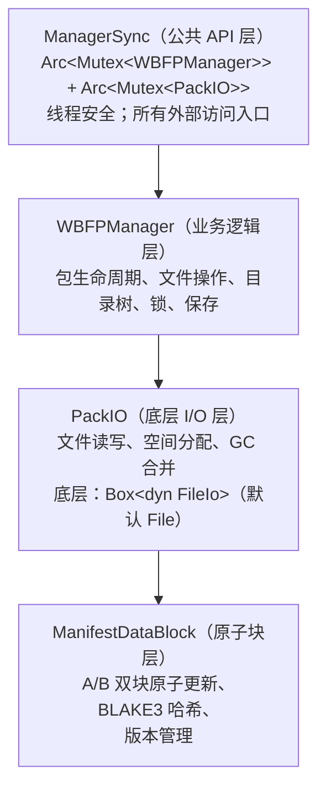
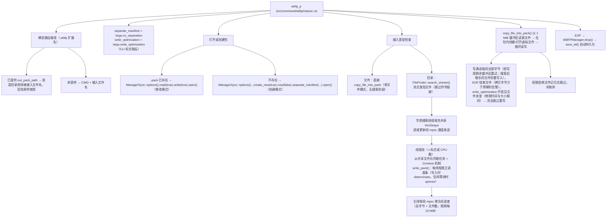
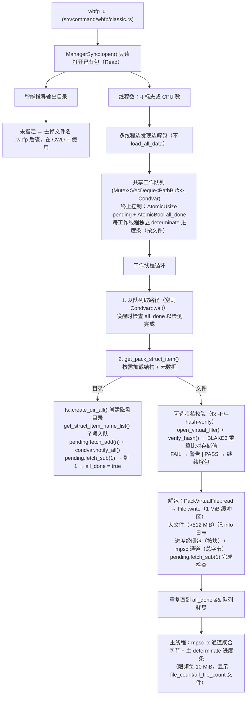
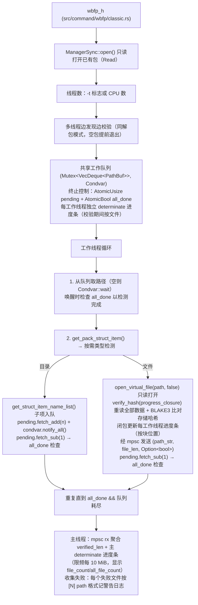
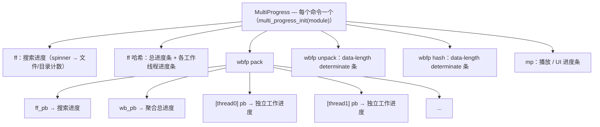
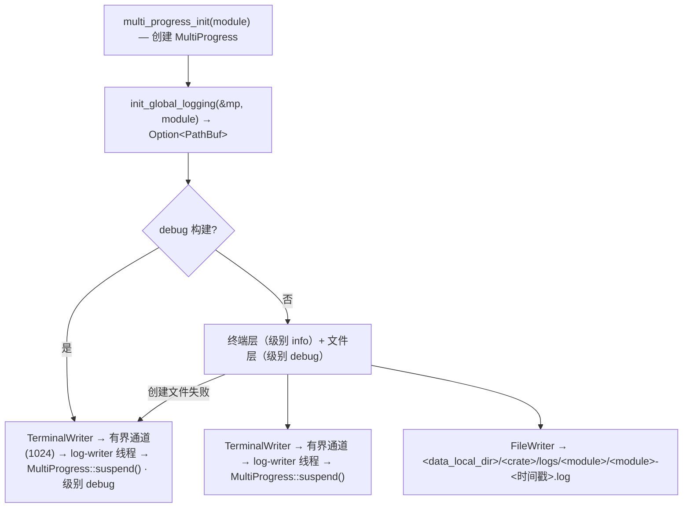

# 水球工具 WaterBall Tool：架构

> **语言**: [English](../ARCHITECTURE.md) | 简体中文

> 最后更新：2026-11-06

---

## 目录

1. [概述](#1-概述)
2. [技术栈](#2-技术栈)
3. [模块依赖图](#3-模块依赖图)
4. [二进制 crate 与库 crate](#4-二进制-crate-与库-crate)
5. [入口点与 CLI 路由](#5-入口点与-cli-路由)
6. [文件搜索器（`ff`）](#6-文件搜索器ff)
7. [音乐播放器（`mp`）](#7-音乐播放器mp)
8. [水球包文件（`wbfp`）](#8-水球包文件wbfp)
9. [进度条系统](#9-进度条系统)
10. [日志系统](#10-日志系统)
11. [工具模块](#11-工具模块)
12. [环形缓冲区模块](#12-环形缓冲区模块)
13. [开发中模块](#13-开发中模块)
14. [测试架构](#14-测试架构)
15. [设计决策与权衡](#15-设计决策与权衡)

---

## 1. 概述

水球工具（WaterBall Tool）是一个多用途 CLI 工具箱，使用 **Rust（edition 2024）** 编写。目前提供三个核心功能：

- **`ff`**：多线程并行文件搜索器，输出 JSON 文件清单，带符号链接循环检测与可选的逐文件哈希
- **`wbfp`**：自定义二进制归档格式（水球包文件 WaterBall Files Pack）：打包、解包、BLAKE3 哈希校验与只读 TUI 浏览器
- **`mp`**：终端音乐播放器：音频播放、播放列表模式、交互式 ratatui TUI，以及实时安全的音频线程架构

仓库是 cargo **workspace**：`water_ball_tool` 二进制 crate（CLI 入口，`src/`）依赖 `water_ball_tool_lib` 库 crate
（`water_ball_tool_lib/src/`），后者暴露可复用模块。


> 部分内容由 AI (deepseek-v4-pro) 生成，以 `//AI===` / `//AI_END===` 标记。

---

## 2. 技术栈

| 类别        | Crate                                                     | 用途                                                       |
|-------------|-----------------------------------------------------------|------------------------------------------------------------|
| CLI         | `clap 4.6`（derive）                                      | 参数解析                                                   |
| 序列化      | `serde` / `serde_json`                                    | 数据结构、JSON 输出                                        |
| 哈希        | `blake3 1.8`                                              | 包文件数据完整性                                           |
| 哈希（CLI） | `sha1` / `sha2` / `blake2b_simd` / `md-5` / `crc32fast`   | `ff` 逐文件哈希算法                                        |
| 进度条      | `indicatif 0.18`                                          | 终端 spinner 与进度条                                      |
| 日志        | `tracing` / `tracing-subscriber`                          | 结构化日志（env-filter）+ 可选日志文件                     |
| 进程检测    | `sysinfo 0.39`                                            | 锁文件的 PID 存活检查                                      |
| 随机        | `rand 0.10`                                               | 随机测试数据（长时间测试：随机目录树搜索压力测试、大夹具） |
| 测试工具    | `pretty_assertions 1.4`                                   | 可 diff 的断言输出                                         |
| 音频        | `cpal 0.18` / `symphonia 0.6` / `rubato 5` / `lofty 0.25` | 音频输出、解码、重采样、标签读取                           |
| 终端 UI     | `ratatui 0.30` / `vtparse 0.7`                            | 交互式 `mp` + `wbfp` TUI + Windows VT 输入                |
| 线程通道    | `crossbeam-channel 0.5`                                   | 实时安全的有界通道（音频回调）                             |

---

## 3. 模块依赖图

```
water_ball_tool（二进制 crate，根包）
  ├── src/main.rs          ← CLI 入口；声明 `mod command;`
  ├── src/command.rs       ← CLI 路由 + 进度条辅助函数
  │   ├── command/ff.rs    ← ff 子命令（搜索 + 可选哈希）
  │   ├── command/wbfp.rs  ← wbfp 模块根（参数 + TUI/经典路径路由）
  │   │   └── command/wbfp/
  │   │       ├── classic.rs   ← 经典 indicatif 路径
  │   │       ├── common.rs    ← 共享路径/复制/解包辅助
  │   │       ├── events.rs    ← TUI 任务事件 + 行状态
  │   │       ├── ops.rs       ← TUI 打包/解包/校验工作线程
  │   │       └── tui/         ← TUI（tui.rs、app.rs、ui.rs、browse.rs）
  │   ├── command/music_play.rs  ← clap 参数 + TUI 接线
  │   │   └── command/music_play/
  │   │       ├── runtime.rs         ← 播放运行时（事件 sink、快照）
  │   │       ├── scanner.rs         ← 后台标签扫描（lofty → ScanMessage）
  │   │       └── tui/               ← 终端 UI（tui.rs、app.rs、ui.rs、channel_writer.rs）
  │   └── command/test.rs  ← 集成测试
  └── 依赖：
      water_ball_tool_lib（库 crate，workspace 成员）
        ├── src/file_finder.rs          ← 文件搜索核心
        │   └── file_finder/test.rs     ← 符号链接测试
        ├── src/wb_files_pack.rs        ← WBFP 模块根
        │   ├── data.rs                 ← 核心数据类型（1762 行，最大模块）
        │   ├── error.rs                ← 错误类型
        │   ├── manager.rs              ← WBFPManager
        │   │   ├── open.rs             ← 创建/打开包文件
        │   │   ├── save.rs             ← 渐进式保存 + 节流
        │   │   ├── file_ops.rs         ← 虚拟文件创建 + 目录创建
        │   │   ├── tree.rs             ← 目录树遍历 + 惰性加载
        │   │   ├── metadata.rs         ← 文件句柄创建 + 元数据更新
        │   │   ├── lock.rs             ← 进程级写锁
        │   │   ├── gc.rs               ← GC 编排
        │   │   ├── delete.rs           ← 虚拟文件/目录删除 + 擦除
        │   │   └── test.rs             ← 内部 API 测试
        │   ├── manager_sync.rs         ← 公共 API 层（Arc<Mutex<>>）
        │   │   └── test.rs             ← 公共 API 测试
        │   ├── pack_io.rs              ← 底层文件 I/O + 空间分配 + GC 合并
        │   │   ├── file.rs             ← FileIo 特征（包后端抽象）
        │   │   ├── pack_file.rs        ← PackVirtualFile（带访问模式强制）
        │   │   ├── file_handle.rs      ← PackFileHandle（493 行，核心文件逻辑）
        │   │   └── file_hash.rs        ← PackFileHash（BLAKE3 状态机）
        │   ├── net_server.rs           ← 网络服务器（开发中，仅 debug 构建）
        │   └── test.rs                 ← 模块级测试
        ├── src/tools.rs                ← 路径工具 + 字节格式化 + 测试辅助
        ├── src/concurrent_ring.rs      ← 可并发初始化的环形缓冲区
        ├── src/split_ring_buffer.rs    ← 读写分离有锁/无锁环形缓冲区
        │   └── inner / reader / writer / mode / error / test
        ├── src/music_play.rs           ← 音乐播放引擎根（LoopMode + 模块树）
        │   ├── player.rs               ← cpal 输出流 + transport + try_stop
        │   ├── decoder_runtime.rs      ← symphonia 解码线程
        │   ├── effect.rs               ← 效果器 trait / 音频类型
        │   │   └── effect/             ← resampler / cross_bridge / fade / runtime
        │   ├── play_list.rs            ← 曲目列表 + 循环/洗牌模式
        │   ├── event_dispatch.rs       ← 实时事件/日志分发线程
        │   └── tools.rs                ← 时间统计 / 耗时累加器
        └── src/gakumasu/               ← 游戏模拟器（开发中，仅 debug 构建）
            ├── data.rs
            └── simulator.rs
```

---

## 4. 二进制 crate 与库 crate

```
Cargo.toml                       → [workspace] resolver = "3"，members = ["water_ball_tool_lib"]
                                   另含 [package] "water_ball_tool"（二进制，src/）
water_ball_tool_lib/Cargo.toml   → [package] "water_ball_tool_lib"（库）
```

**关键规则**

- 根包是二进制 crate `water_ball_tool`；`main.rs` 声明 `mod command;`——`command.rs` 对二进制 crate **私有**。
- 库 crate `water_ball_tool_lib` 导出：`file_finder`、`wb_files_pack`、`tools`、`concurrent_ring`、`split_ring_buffer`、
  `music_play`，以及 `gakumasu`（由 `#[cfg(debug_assertions)]` 门控，仅 debug 构建编译）。
- 二进制代码通过 crate 名限定路径引用库——`water_ball_tool_lib::file_finder`、`water_ball_tool_lib::wb_files_pack`、
  `water_ball_tool_lib::tools`、`water_ball_tool_lib::music_play` 等——而非 `crate::file_finder`。
- 两个包通过 `[workspace.package]` / `[workspace.dependencies]` 共享元数据与依赖。

**依赖流向**



---

## 5. 入口点与 CLI 路由

### `main.rs`：入口点（344 行）

```
1. Cli::parse()        — clap derive 解析 CLI 参数
2. command::cli(cli)   — 路由到子命令处理函数
3. 子命令处理函数      — 经典路径调用 multi_progress_init(module) 创建 MultiProgress 并安装全局 tracing subscriber；
                         wbfp/mp TUI 改为安装 TUI channel writer
4. Err 包装            — 打印错误并以 -1 退出
```

日志级别与日志文件路由在 `init_global_logging(&mp, module)` 内配置——见 §10。

### `command.rs`：CLI 路由（100 行）

```rust
Cli {
    command: Commands::Ff(FileFinderArgs) | Commands::Wbfp(WaterBallFilePackCommand)
           | Commands::MP(music_play::MusicPlayArgs)
}
```

进度条辅助函数

| 函数                           | 用途                                                   |
|--------------------------------|--------------------------------------------------------|
| `create_pb(mp) -> ProgressBar` | 创建并注册自动旋转的 spinner（100 ms tick）            |
| `progress_style(template)`     | 构造 `ProgressStyle`；模板非法 → 默认样式 + error 日志 |

常量

| 常量                           | 值     | 用途                                                        |
|--------------------------------|--------|-------------------------------------------------------------|
| `BUF_LEN`                      | 10 MiB | 读写缓冲区大小                                              |
| `PACK_PROGRESS_STYLE_TEMPLATE` | —      | 打包/解包/哈希进度条模板（前缀、进度条、ETA、百分比、字节） |
| `SPINNER_TEMPLATE`             | —      | 空闲/挂起工作线程 spinner 模板                              |

---

## 6. 文件搜索器（`ff`）

### 6.1 多线程工作队列模型

架构：**共享工作队列 + 阻塞弹出**模式。队列是 `ConcurrentRing<DirEntry>`（见 §12.1），没有独立的条件变量与运行线程计数。



**工作线程生命周期**

1. 生成时：进入循环
2. 循环：从队列 `pop_wait()`（队列为空时阻塞）
3. 写入一个目录会唤醒一个阻塞的工作线程
4. 队列为空且没有其他线程能再写入 → `pop_wait()` 返回 `WritersClosed` / `AllWaiting` → 线程退出

**进度限频**：每 50 个文件 / 10 个目录通过 `pb.send((delta_files, delta_dirs))` 触发一次。

**命令层线程创建**：`ff` 处理函数中的结果收集线程、进度聚合线程与哈希工作线程用
`thread::Builder::new().name(...).spawn(...)` 创建，spawn 失败作为错误传播（禁止会 panic 的 `std::thread::spawn`）；
取出本应存在的工作线程进度条属于逻辑错误，用 `unreachable!` 中止。

### 6.2 符号链接循环检测

每个工作线程维护独立的 **inode 链**（`Vec<InodeKey>`），由 `DirEntry` 携带：

```rust
struct DirEntry {
    path: PathBuf,
    symlink_chain: Vec<InodeKey>,  // 此路径上经符号链接进入的目录的 inode 链
}
```

**检测流程**



**平台差异**

| 平台    | InodeKey 类型 | 提取方法                      |
|---------|---------------|-------------------------------|
| Unix    | `u128`        | `(dev << 64) \| ino`          |
| Windows | `PathBuf`     | `canonicalize()` 回退到原路径 |

> **理由**：普通目录在正常文件系统中无法形成循环；只有符号链接才能闭合环路。这使检测机制精确作用于需要之处，对普通文件和目录零开销。

### 6.3 核心数据结构

```rust
pub struct FilesList {
    path: String,                            // 根搜索路径
    data_length: u64,                        // 总数据大小
    file_count: u64,                         // 文件数（不含目录）
    dir_count: u64,                          // 目录数
    files_list: HashMap<String, FileInfo>,   // 根的直接子项
}

pub struct FileInfo {
    name: String,           // 名称（不含路径）
    length: u64,            // File=实际大小, Dir=子树累计大小
    modified_time: u128,    // 自 UNIX 纪元起的毫秒数
    file_kind: FileKind,
}

pub enum FileKind {
    File {
        hash: Option<HashMap<String, String>>,  // 逐文件哈希（仅在给出 [HASH]... 时）
    },
    Dir(Dir),
}

pub struct Dir {
    files_list: HashMap<String, FileInfo>,  // 直接子项
    file_count: u64,                        // 后代文件累计数
    dir_count: u64,                         // 后代目录累计数
}
```

### 6.4 流式搜索 API

| 特性                | `search()`               | `search_stream()`                       |
|---------------------|--------------------------|-----------------------------------------|
| `FilesList` 树      | `Some(results)` — 完整树 | `None`（跳过 HashMap）                  |
| `HashMap`（内存中） | 收集                     | 无（零开销）                            |
| 阻塞式、一次性      | 是                       | 否——返回 `(JoinHandle, Receiver<...>)`  |
| 使用方              | `ff` 命令                | `wbfp` 打包、`ff` 哈希（生产者-消费者） |

### 6.5 树重建

并行扫描产生扁平的 `HashMap<PathBuf, FileInfo>`。`build_tree()` 重建嵌套的 `FilesList`：

1. 按父路径对所有条目分组 → `HashMap<PathBuf, Vec<PathBuf>>`
2. 迭代式基于栈的后序构建（Pre/Post 状态机，带显式 `Fr` 帧），避免深层嵌套层次栈溢出；父子链接使用 `rposition()` 向后搜索以正确匹配路径
3. 目录 `length` = 所有后代文件大小之和
4. 目录 `file_count`/`dir_count` = 所有子目录的累计值

### 6.6 哈希计算

- CLI：`[OUT_PATH]` 之后的可选多值位置参数 `[HASH]...` 接受 `all`、`md5`、`sha256`、`sha512`、`sha1`、`blake3`、
  `blake2b`、`crc32`（别名 `*`、`m5`、`s256`、`s512`、`s1`、`b3`、`b2b`、`crc`）。
- 实现（`command/ff.rs`）：`HashTypeS` 为每个选中的算法持有一个 hasher，并提供 `update`、`reset`、
  `finalize_reset_str_map`（十六进制字符串），因此多个算法共享一次读取。
- 开启哈希时以 `ff_thread_count = 1` 调用 `search_stream()`；发现的文件条目被推入 `ConcurrentRing`，由 `thread_count`
  个哈希工作线程（取自 `-t/--thread-count` 或可用并行度）取出条目、用 10 MiB 缓冲区读取文件、计算哈希，并把带
  `FileKind::File { hash: Some(map) }` 的新 `FileInfo` 写入结果表。
- 主线程通过 mpsc 通道汇总各工作线程进度（按每 10 MiB 限频）。
- 选择 MD5/SHA-1 时记录不安全警告。所有代码路径（打开失败、读取失败、EOF 不匹配、通道断开）都会 reset hasher，保证
  下一文件从干净状态开始。

---

## 7. 音乐播放器（`mp`）

**文件**：引擎位于 `water_ball_tool_lib/src/music_play/`（约 3,100 行）；终端前端位于 `src/command/music_play.rs` +
`src/command/music_play/`（约 850 行）

### 7.1 概述

`mp` 是终端音乐播放器，命令流程：

1. 校验音量参数并安装 TUI 日志 subscriber（日志进入面板，见 §7.7）。
2. 创建 `Runtime`（播放器 + 播放列表 + 事件 sink）并启动 `mp-scan` 线程：遍历 `files...`、用 `lofty` 读取标签
   （目录只接受 `lofty` 能识别的扩展名，显式传入的文件总是尝试），把
   `ScanMessage::{Track, Progress, Done}` 发送给 TUI 循环。
3. 初始化终端并运行 `tui::run`：取日志/扫描消息 → 应用运行时快照 → 每 50ms 渲染一次。初始化只加载第一首并保持暂停：
   顺序模式在首曲到达时立即初始化；`shuffle`/`periodic-shuffle` 先等 5 首，若扫描结束时不足 5 首则用已扫描到的曲目
   兜底初始化。只有带 `-a/--autoplay`（或用户按下播放）才真正开始播放。按键：`n` 下一曲、`←`/`→` 跳转进度
   （点按 5 秒，长按期间预览、松开后提交）、空格 播放/暂停、`p` 暂停、`P` 播放、`+`/`-` 音量、`:` 命令模式、
   `q`/`Esc`/`Ctrl+C` 退出。

CLI 参数（`MusicPlayArgs`）：

| 参数                 | 默认值            | 用途                                                                         |
|----------------------|-------------------|------------------------------------------------------------------------------|
| `files...`           | —                 | 要播放的音频文件/目录                                                        |
| `-v, --volume <f32>` | `0.75`            | 初始音量，0.0–1.0（超出该范围会在开始播放前返回参数错误）                    |
| `--verbose`          | 关                | 详细输出（仅长选项）                                                         |
| `-a, --autoplay`     | 关                | 找到第一首后自动播放；不带该参数时第一首只加载并保持暂停                     |
| `-m, --mode <MODE>`  | `sequential-loop` | `sequential-loop`、`sequential`、`repeat-one`、`shuffle`、`periodic-shuffle` |

### 7.2 模块

播放引擎位于库 crate，不依赖终端 UI；只有 `runtime.rs`、`scanner.rs`、clap 处理函数和 `tui/` 留在二进制包。

| 模块（所在 crate）             | 职责                                                                                                                                                                                                |
|--------------------------------|-----------------------------------------------------------------------------------------------------------------------------------------------------------------------------------------------------|
| `music_play.rs`（库）          | 引擎模块根；持有 `LoopMode`（含 `FromStr`）并声明各子模块                                                                                                                                           |
| `player.rs`（库）              | cpal 输出流、`PlayCmd` transport、音量/位置原子量、事件 sink、`Player::try_stop`                                                                                                                    |
| `decoder_runtime.rs`（库）     | symphonia 解码线程：探测/seek 文件，把解码音频写入前效果器环形缓冲区；持有成对的 `DecoderSession`                                                                                                   |
| `effect.rs`（库）              | `PostEffect`/`PreEffect` trait、`AudioFormat`、`PlayCmd`、效果器链                                                                                                                                  |
| `effect/runtime.rs`（库）      | 带锁的前效果器运行时线程（事件 sink、停止/拒绝写入处理）                                                                                                                                            |
| `watchdog.rs`（库）            | 崩溃看门狗：`ThreadExitGuard`（Drop → 经 `Condvar` 通知）+ `Player` 持有的单一看门狗线程                                                                                                            |
| `effect/resampler.rs`（库）    | rubato FFT 重采样到输出设备采样率                                                                                                                                                                   |
| `effect/cross_bridge.rs`（库） | 曲目之间的交叉淡入淡出桥接：延迟线未满时非对称输入/输出（低启动延迟），短尾时缩放整条增益曲线                                                                                                       |
| `effect/fade.rs`（库）         | 淡入淡出与暂停/恢复 transport 处理                                                                                                                                                                  |
| `play_list.rs`（库）           | `Track` 列表、循环模式、洗牌队列、下一曲选择、上一曲的播放轨迹、`jump_to`（周期洗牌中目标在待播队列时取出）、追加与插入                                                                             |
| `event_dispatch.rs`（库）      | 面向实时回调的事件/日志专用分发线程                                                                                                                                                                 |
| `tools.rs`（库）               | `TimeMetrics` / `DurationAccumulator` 性能统计                                                                                                                                                      |
| `runtime.rs`（bin）            | TUI 播放运行时：播放器 + 共享播放列表，`add_track`/`play`/`pause`/`next_track`/`prev_track`/`seek`/`set_loop_mode`/`snapshot`/`stop`，解码 Eof 无缝自动换曲（`no_clear`）、启动错误策略，无 UI 线程 |
| `scanner.rs`（bin）            | `mp-scan` 线程：经 lofty 读取标签/专辑/音频信息 → `ScanMessage::{Track, Progress, Done}`                                                                                                            |
| `tui/`（bin）                  | 终端 UI（`tui.rs`、`app.rs`、`ui.rs`、`channel_writer.rs`）：50ms 循环、渲染、按键映射、日志通道                                                                                                    |

### 7.3 实时音频线程

数据流：解码线程 → 前效果器环形缓冲区 → 前效果器运行时 → 分离环形缓冲区（无锁读端）→ cpal 回调 → 设备。

cpal 回调运行在实时上下文，因此：

- 从不获取阻塞锁（效果器链用 `try_lock`，音频数据用分离环形缓冲区的无锁读端），
- 从不直接调用 `PlayerEventSink`，
- 从不写日志。

分离环形缓冲区的无锁读端在发布 `read.pos` 之后再检查是否有等待中的写者；该检查两侧都有 `SeqCst` 屏障
（发布方在 `notify_*_after_*`、等待方在 `enter_wait`），因此“发布方跳过唤醒”与“等待方读到旧位置”不会同时发生
——否则对端会永远睡下去。这里只用屏障、不取锁，回调路径仍是实时安全的。

它只用非阻塞 `try_send` 把事件（`TrackEnded`）与日志记录投递到 `EventDispatcher` 的有界通道
（`DISPATCH_CHANNEL_CAPACITY = 1024`）。通道满时丢弃该消息并递增丢弃计数（停止时以 debug 级别报告）。

`player-event-dispatch` 线程负责真正的工作：对 sink 列表加锁、调用 `PlayerEventSink::emit`，并通过正常日志管线输出
`tracing` 事件（含流错误）。

transport 命令（`PlayCmd::{Play, Pause, Seek, ClearEofBuf}`）经有界 crossbeam 通道从命令侧送往回调；被接受的命令再经无界
通道回报给 `rx_cmd` 线程，由它驱动 `stream.play()` / `stream.pause()`。

### 7.4 解码器运行时与错误传播

- 解码器把 symphonia engine（格式读取器 + 解码器）与 data（轨道元数据）合并保存在单个
  `Arc<Mutex<Option<DecoderSession>>>` 中的 `DecoderSession` 里。换曲时在同一把锁内整体替换或取出会话，因此不会出现
  「有 engine 但缺 data」的状态；旧的 engine/data 两个独立 `Option` 及其缺 data 分支已删除。
- `DecoderRuntime::run()` 与 `PreEffectRuntime::run()` 返回 `Result`；线程 spawn 失败会中止 `Player::new()` 并返回错误，
  不再只记日志后继续。
- 解码循环错误策略：
    - 瞬时 IO 错误（见 `DecoderRuntime::is_retryable_io_error`，如 Windows 1450 `ERROR_NO_SYSTEM_RESOURCES`）先重试，
      最多 5 次、每次间隔 200 ms，耗尽后才视为失败；
    - 不可重试或重试耗尽的真实运行期失败——`next_packet` 失败、环形缓冲区真实写入失败、EOF 写入失败、非帧级致命解码错误
      ——发出 `DecoderEvent` 错误事件，随后取出会话、清空待写输出缓冲并回到 condvar 等待；解码线程保持存活，后续换曲仍能
      播放；
    - 同类失败会置位原子 `poisoned` 标志（`DecoderRuntime::is_poisoned`）。换曲成功（`DecoderRuntime::set_decoder_path`）
      会自动清除它，前端不可能忘记解毒，从而不会把后续播放命令变成提前换曲；
    - 单帧 `DecodeError` 可恢复：上报后跳过该帧继续；
    - 停止、切曲、寻道时的 `WriteRejected` 属于正常控制流，不是错误。
- 二进制前端通过 `DecoderEventChannelSink` 消费解码错误事件（在通道线程上，绝不在解码线程内联）并暂停播放。下一次
  `play` 会看到 `is_poisoned()`，先换曲再恢复播放；TUI 显示 `异常暂停中` 状态，并在正在播放块中显示红色 `Error` 行。
- `DecoderRuntime::stop()` 记录 `send_skip` 失败，始终先 join 解码线程，然后返回第一个错误；`Player::try_stop`
  记录停止失败并继续其余关闭步骤。
- 前效果器运行时线程遇到运行期错误不退出：环错误先用 `Skip` 不连续信号复位效果链，发出
  `PreEffectRuntimeEventErrorKind::Runtime` 事件，退避 10 ms 后继续消费（写端关闭时因此改为等待而不是空转）；输出写入
  硬错误同样只上报并丢弃该块。只有 `stop` 标志才结束循环。二进制通过 `PreEffectRuntimeEventChannelSink` 记录这些事件
  （仅信息性，播放可继续）。
- 事件通道 sink 构造器（`PlayerEventChannelSink::create`、`DecoderEventChannelSink::create`、
  `PreEffectRuntimeEventChannelSink::create`）返回 `Result`；DirectSink 的构造不会失败。`Player::new()` 与
  `Runtime::new()` 会传播 sink 与线程 spawn 失败。

### 7.5 退出（`Player::try_stop`）

`try_stop()` 幂等，并按固定顺序回收所有线程：

1. 关停看门狗（`WatchNotify::shutdown`），避免它在关停过程中重启线程。
2. 暂停音频流并清除 `is_playing`，不再产生新事件。
3. 停止前效果器运行时——其 `reject_waiting_writers` 会唤醒阻塞在 `push_wait` 的生产者，避免 join 死锁。
4. 停止解码线程。
5. 停止事件分发线程（发送 `Stop` 消息并 join）。
6. 通过 player 中保存的句柄 join `rx_cmd` 线程。
7. join 看门狗线程。

任一步骤失败都只记日志、不向上传播；`Runtime::run_stop` 还会额外 join UI 线程。

### 7.6 崩溃看门狗（`watchdog.rs`）

- 被监视线程（`decoder-runtime`、`pre-effect-running`）在线程闭包内持有 `ThreadExitGuard`。其 `Drop`（含 panic unwind）
  在 `WatchNotify` 中置位本线程槽位，并通过 `Condvar` 唤醒唯一的看门狗线程——既不轮询 `JoinHandle::is_finished()`，也
  不需要第二个线程。
- `Player::new` 在 `run()` 之前把通知器注入两个运行时，并启动 `player-watchdog`。
- 线程退出时看门狗暂停播放（绝不自动恢复），置解码器毒化标志让 `Play` 走换曲恢复，并重启死掉的线程（`run()` 先回收已结束的
  `JoinHandle`）。前效果器线程则在重启前用 `Player::new` 注册的工厂整条重建效果链，因为旧效果器可能已被毒化。
- `try_stop` 在停线程之前先关停看门狗、最后 join 它，因此正常退出不会触发重启。

### 7.7 TUI

**文件**：`src/command/music_play/tui/`（`tui.rs`、`app.rs`、`ui.rs`、`channel_writer.rs`）

- `tui::run` 每 50ms 轮询一次，取日志与扫描消息、应用 `Runtime::snapshot()`，渲染正在播放 / 进度 / 播放列表 / 日志 /
  快捷键
- 播放列表视口：只渲染可见行；`↑`/`↓` 滚动一行、`PageUp`/`PageDown` 滚动一页、`Home`/`End` 跳到首尾，鼠标滚轮滚动三行，
  左键点击某行会切换并播放该曲（`Runtime::play_at` → `PlayList::jump_to`）。底栏快捷键文字本身也可点击，分别对应退出、
  下一曲、快退/快进、播放/暂停、单行滚动、音量、Debug 与命令模式。换曲时视口跟随当前曲目，在此之前保留用户
  手动滚动的位置。TUI 主循环期间启用鼠标捕获，恢复终端前释放。Windows 下 TUI 会打开
  `ENABLE_VIRTUAL_TERMINAL_INPUT`、请求 SGR 鼠标上报，并用 `vtparse`（`VtInput`）解析 VT 字节流；这样可避开
  crossterm 的控制台鼠标记录——部分 ConPTY 终端会把它拆成裸 X10 负载字节。VT 模式下键盘改为专用线程直接读取
  stdin 字节，而不是走 `crossterm::event`：crossterm 0.29 会丢弃合成 VT 输入中的 ESC、CR 等控制字符；
  单独的 ESC 等待短暂超时后才作为 Esc 键。若无法启用 VT 输入，则禁用鼠标，键盘输入仍然可用
- 启动：顺序模式在首曲到达时初始化（加载第一首）；随机模式先等 5 首，扫描结束（`ScanMessage::Done`）时不足 5 首则用
  已扫描到的曲目兜底初始化
- 按键：`n` 下一曲、`←`/`→` 跳转进度（点按 5 秒；长按重复只移动预览，松开后提交）、空格 播放/暂停、`p` 暂停、
  `P` 播放、`↑`/`↓`/`PageUp`/`PageDown`/`Home`/`End` 滚动播放列表、
  `+`/`-` 音量、`d`/F12 切换 Debug 弹窗、`:` 命令模式、`q`/`Esc`/`Ctrl+C` 退出。弹窗显示缓冲区长度、解码路径/格式、
  播放列表状态、各段耗时（`TimeMetrics` 窗口）、`lock_fail` 与 `underrun`
- 命令模式：`:` 把底栏变为输入行（`Enter` 执行、`Esc` 取消、`Backspace` 编辑）。命令按唯一前缀匹配：`quit`、`play`、
  `pause`、`toggle`、`next`、`prev`、`seek <mm:ss|+N|-N>`、`vol <0-100|+N|-N>`、`mode <name>`、`goto <n>`、`debug` 与
  `help`/`?`；未知或歧义命令在底栏报错。`help` 打开命令表弹窗，`prev` 沿 `PlayList::prev` 的历史回退，`goto` 复用
  `Runtime::play_at`，`mode` 调用 `Runtime::set_loop_mode`。`:seek` 走 `Runtime::seek` → `Player::try_seek`：清空输出环、
  用解码器准确 seek 并做 `Seek` 基本复位、作废旧 EOF 状态、重设进度基准；显示进度与真实位置可能相差一个音频块。
  `Runtime::seek` 在换曲期间或 EOF 尾部/交叉渐变尚未播完时忽略请求，因为该窗口内 `pos` 仍包含上一曲的样本。
- `channel_writer` 持有 tracing subscriber（有界 1024，满则 `try_send` 丢弃）；面板把时间戳压暗并按级别给级别词着色。
  Debug 构建把 `debug` 记录写到项目的 `temp/logs/<module>/`（基于 `CARGO_MANIFEST_DIR`）；Release 构建面板保持
  `info`，`debug` 日志文件写到用户数据目录
- `mp` 串联 panic hook 并以 `error` 级别记录 `tui::run` 错误，崩溃后日志文件仍留有线索；按键与鼠标事件以 `debug`
  级别记录

---

## 8. 水球包文件（`wbfp`）

**文件**：`water_ball_tool_lib/src/wb_files_pack/*.rs`（共约 6,000+ 行），以及二进制 crate 前端
`src/command/wbfp/*`（经典进度条路径、TUI、操作执行器）。

### 8.1 总体架构

WBFP 采用 **三层架构**：



### 8.2 二进制格式

完整规范（中文）见 `docs/zh_CN/wb_files_pack/manifest-data.md`。摘要：

```
.pack 文件布局
┌────────────────────────────────────────────────────────┐
│  FILE_HEADER_BLOCK_LEN (128 + attribute block)         │
│  ├─ File header: magic "WBFilesPack", ver [0,2]        │
│  │   ├─ type_name (11B)                                │
│  │   ├─ version (2B)                                   │
│  │   ├─ bool_data (1B) — cow bit[0], s_manifest bit[1] │
│  │   ├─ pack_len (8B)                                  │
│  │   └─ padding to 128B                                │
│  └─ Embedded Attribute manifest data block             │
├────────────────────────────────────────────────────────┤
│  Data Region                                           │
│  ├─ File data blocks (DATA_DATA_BLOCK_LEN-aligned)     │
│  └─ (optional) manifest data (when !separate_manifest) │
├────────────────────────────────────────────────────────┤
│  Manifest Index                                        │
│  ├─ DataPosList (data free region list)                │
│  ├─ DataPosList (manifest free list, separated only)   │
│  ├─ PackStruct (root directory)                        │
│  │   └─ PackStructItem ... (recursive)                 │
│  └─ PackFileMetadata ... (per file/dir)                │
└────────────────────────────────────────────────────────┘
```

**关键常量**

| 常量                          | 值    | 用途             |
|-------------------------------|-------|------------------|
| `DATA_BLOCK_LEN`              | 128 B | 清单数据对齐单位 |
| `DATA_DATA_BLOCK_LEN`         | 4 MiB | 文件数据分配单位 |
| `MANIFEST_VERSION`            | 10    | 当前清单格式版本 |
| `MANIFEST_VERSION_COMPATIBLE` | 10    | 最低兼容版本     |

### 8.3 核心数据结构

```rust
/// 顶层清单
pub struct WBFilesPackManifest {
    attribute: Attribute,         // 全局属性（常驻内存）
    root_struct: PackStruct,      // 根目录结构
    file: Option<PackIO>,         // 清单文件 I/O（分离模式）
}

/// 全局属性 — 包文件元数据
pub struct Attribute {
    version: u16,                              // 格式版本
    version_compatible: u16,                   // 兼容版本
    cow: bool,                                 // 写时复制
    empty_data_pos_list_pos: u64,              // 数据空闲列表位置
    manifest_empty_data_pos_list_pos: u64,     // 清单空闲列表位置
    manifest_file_len: u64,                    // 清单文件长度
    root_struct_pos: u64,                      // 根结构位置
    file_count: u64,                           // 总文件数
    dir_count: u64,                            // 总目录数
    data_len: u64,                             // 总数据大小
    data_block: ManifestDataBlock,
    dirty: bool,                               // 脏标记
}

/// 目录结构节点
pub struct PackStruct {
    items: HashMap<String, PackStructItem>,    // 子项
    data_block: ManifestDataBlock,
    dirty: bool,
}

/// 目录条目
pub struct PackStructItem {
    name: String,
    metadata_file_pos: u64,                    // 元数据位置
    item_type: PackStructItemType,
    metadata: PackFileMetadataRun,             // 状态机
}

pub enum PackStructItemType {
    File { handle: Option<Weak<Mutex<PackFileHandle>>> },
    Dir { struct_file_pos: u64, pack_struct: Option<PackStruct> },
}

/// 元数据状态机 — 控制访问生命周期
pub enum PackFileMetadataRun {
    None,                                       // 无元数据
    NoLoad,                                     // 尚未加载
    Loaded(Box<PackFileMetadata>),              // 就绪可用
    Locked,                                     // 写入进行中
}

pub enum PackFileMetadataType {
    File {
        hash_type: u8,                          // 1 = BLAKE3
        hash_value: Vec<u8>,                    // 哈希值
        data_pos_list: DataPosList,             // 已分配块位置
    },
    Dir {
        file_count: u64,                        // 子文件累计数
        dir_count: u64,                         // 子目录累计数
    },
}

/// 双用途位置列表
///   PackIO.empty_data_list  → 跟踪 FREE（可复用）区域
///   PackFileMetadata.data_pos_list → 跟踪 ALLOCATED（已分配）块
pub struct DataPosList {
    data_block: Option<ManifestDataBlock>,
    list: Vec<(u64, u64)>,                      // (位置, 长度) 对
}
```

### 8.4 清单数据块：A/B 双块机制

**文件**：`water_ball_tool_lib/src/wb_files_pack/data.rs`（1762 行，最大的单一模块）

所有索引数据（Attribute、PackStruct、PackFileMetadata、DataPosList）都存储在 `ManifestDataBlock` 实例中。

**A/B 双块结构**

```
┌──────── A Block ────────┬──────── B Block ────────     ┐
│ len(8) │ ver(4) │ hash(8) │ data(...) │ ver(4) │ ...   │
└─────────────────────────┴─────────────────────────     ┘
──────────────────────────────────────────────────────────
        Entire block = aligned to multiples of DATA_BLOCK_LEN (128B)
```

**原子更新流程**

1. 读取两个半块，提取各自的版本号
2. 写入版本 **较低**的半块（`ver + 1`）
3. 另一半块保持不变
4. 部分写入后崩溃 → 至少保留一个完整版本

**读取流程**

1. 检查 A 块头尾版本匹配（快速完整性检查）
2. 同样检查 B 块
3. 选择通过校验且版本较高的半块

**块大小计算**

```
block_len = ceil((24 + data_len) × 2 / DATA_BLOCK_LEN) × DATA_BLOCK_LEN
```

**版本回绕**

```rust
fn next_ver(ver: u32) -> u32 {
    if ver == u32::MAX { 1 } else { ver + 1 }
}

// 使用包装减法正确处理 u32 回绕
fn ver_is_older(a: u32, b: u32) -> bool {
    a != b && b.wrapping_sub(a) < a.wrapping_sub(b)
}
```

### 8.5 空间分配与垃圾回收

**核心文件**：`water_ball_tool_lib/src/wb_files_pack/pack_io.rs`（402 行），PackIO 层

**空间分配 `get_file_pos(length)`**

```
1. Align length to DATA_BLOCK_LEN (128B) boundary
2. Try free list first (empty_data_list):
   └─ Exact match → remove from list, return
   └─ Larger than needed → split: allocate front, keep remainder
3. No suitable free block → extend file: return (file.len, length)
```

**数据分配**
Pass 1
`get_pos_contiguous`
`MAX_DATA_SEGMENTS`(16)

- 已知大小（`alloc_size(Some(len))`，例如搜索已得知长度）通过 `get_file_pos` 以 128B 对齐精确分配，与包全局对齐规则一致，无浪费。未知大小（
  `alloc_size(None)`，默认）通过 4MiB 对齐的 `get_data_file_pos_multi`（初始 `create_file_raw`）分配，先复用空闲碎片：第 1
  遍单块首次适配（`get_pos_gc`）→ 第 2 遍物理相邻碎片的连续链（`get_pos_contiguous`）→ 第 3 遍最大优先累积（
  `get_pos_biggest`）；`empty_data_list` 顺序从不改变；碎片不足时回退为扩展文件。段数计入虚拟文件的数据段列表（
  `data_pos_list` 现有 + 新增），上限 `MAX_DATA_SEGMENTS`（16）；超限分配以错误拒绝（无部分写入）。碎片由 `file_gc`（在
  `save_all` 期间）批量排序并入 `empty_data_list`，之后才参与复用。打开已有文件时忽略 `alloc_size`（绝不缩小已有分配）。清单数据始终使用
  128B 对齐的 `get_file_pos`。

**垃圾回收**

```
Stage 1 — Staging (file_gc_add):
   ├─ PackFileHandle drops → manager → file_gc_add buffers into gc_data_pos_list

Stage 2 — Merging (file_gc):
   ├─ Append staging items to empty_data_list, then batch sort_unstable_by_key(pos)
   │  O((K+M) log(K+M))
   │  batch sort replaces the previous insertion sort
   ├─ Single-pass merge adjacent: pos1 + len1 == pos2 → merge into one block
   └─ Write updated empty data list
```

**GC 触发点**

- `WBFPManager.save_all()` → `file_gc()` + `manifest_file_gc()`
- 文件缩小或覆写 → `PackFileHandle::commit_data()`（drop 时）/ drop

### 8.6 渐进式保存

**文件**：`water_ball_tool_lib/src/wb_files_pack/manager/save.rs`（200 行）

**节流条件 `throttled_save()`**

```rust
// 触发 save_all() 的条件：
if all_write_len - last_all_write_len > 64 * 1024 * 1024  // 已写入 64MiB
   || all_cr_file_count - last_all_cr_file_count > 10_000  // 或新增 10K 文件
```

**`save_all()` 流程**

1. `file_gc()`：数据区垃圾回收
2. `manifest_file_gc()`：清单文件垃圾回收
3. `save_root_pack_struct()`：持久化根结构（dirty 检查）
    - 若 dirty，同时调用 `save_manifest_attribute()`
4. `save_pack_length()`：更新文件头中的 pack_len

**Dirty 标志链**

`save_all()`（可见性：`pub(crate)`）也会在 `WBFPManager.drop()` 中被调用，进程退出时数据始终持久化（除非发生 panic）。

### 8.7 进程级写锁

**文件**：`water_ball_tool_lib/src/wb_files_pack/manager/lock.rs`（134 行）

```
Flow
1. Create .lock file, write current PID as little-endian u32
2. sync_all() — ensure persistence
3. File::lock() — acquire OS-level exclusive lock
4. On process exit (Drop): file.unlock() + delete .lock file
```

**锁检测 `write_lock_info()`**

- 从 `.lock` 文件读取 PID
- `sysinfo::System::new_all()` → 检查 PID 是否存活
- PID 不存活 → panic，提示手动移除锁文件
- `.lock` 是目录 / 符号链接 → 报错（异常状态）

### 8.8 公共 API 层：ManagerSync

**文件**：`water_ball_tool_lib/src/wb_files_pack/manager_sync.rs`（438 行）

`ManagerSync` 是包住 `WBFPManager` + `PackIO` 的线程安全包装：

```rust
#[derive(Clone)]
pub struct ManagerSync {
    access_mode: PackAccessMode,  // 在打开时强制只读/只写/读写
    manager: Arc<Mutex<WBFPManager>>,
    pack_io: Arc<Mutex<PackIO>>,
}
```

**公共 API 面**

| 类别          | 方法                                                                             | 用途                                                                                   |
|---------------|----------------------------------------------------------------------------------|----------------------------------------------------------------------------------------|
| **打开/创建** | `open(path)`                                                                     | 只读打开已有包                                                                         |
|               | `create_new(path)`                                                               | 创建新包（使用 PackOpenOptions 默认值），已存在则失败                                  |
|               | `options() -> PackOpenOptions`                                                   | 完整构造器：`read()`/`write()`/`create()`/`create_new()`/`cow()`/`separate_manifest()` |
| **虚拟文件**  | `open_virtual_file(path, end_pos)`                                               | 只读打开已有虚拟文件                                                                   |
|               | `create_virtual_file(path)`                                                      | 只写创建新虚拟文件                                                                     |
|               | `virtual_file_options() -> VirtualFileOpenOptions`                               | 构造器：`read()`/`write()`/`create_new()`/`end_pos()`/`alloc_size()`                   |
| **读取**      | `get_manifest_attribute` / `get_root_struct_items` / `get_dir` / `load_all_data` |                                                                                        |
| **写入**      | `create_dir_all` / `delete_file` / `delete_dir_all`                              |                                                                                        |
| **删除**      | `delete_file` / `delete_dir_all`                                                 | 移除元数据 + 结构，数据块提交 GC（不覆写）                                             |
| **擦除**      | `erase_file(strategy)` / `erase_dir_all(strategy)`                               | 覆写数据 + 清单块 → GC → 移除                                                          |
| **校验**      | `verify_all_file_hash`                                                           | 递归哈希校验所有文件                                                                   |

**覆写策略**

| 策略      | 遍数 | 说明                                              |
|-----------|------|---------------------------------------------------|
| `Zero`    | 1    | 单遍 0x00                                         |
| `Random`  | 1    | 单遍随机字节                                      |
| `Dod5220` | 3    | DoD 5220.22-M：0x00 → 0xFF → 随机（每遍写入磁盘） |

> `PackStruct` 上的 `child_locked_count` 跟踪有多少后代文件持有活动写句柄。仅当 `child_locked_count == 0` 时目录才能被删除/擦除。

**设计说明**

- `Arc<Mutex<>>` 保证线程安全，多个 `PackVirtualFile` 实例可并发操作
- 每个方法都获取 manager 锁 → 串行访问
- `ManagerSync` 实现 `Clone`，多个持有者共享同一个包引用 / Clone

### 8.9 虚拟文件 I/O：PackVirtualFile + PackFileHandle

**PackVirtualFile**（`pack_io/pack_file.rs`，210+ 行），由 `PackFileWR` 更名：

- 实现 `Read + Write + Seek` trait，带 **访问模式强制**
- 持有 `Arc<Mutex<PackFileHandle>>`
- 跟踪 `pos`（当前读写位置）+ `AccessMode`（Read/Write/ReadWrite）
- 所有操作委托给 `PackFileHandle`
- 通过 `VirtualFileOpenOptions` 构造器模式打开（兼容 std::fs::File）
- `get_len()` 返回 `u64`（非 `Result<u64>`）；`get_modified()` 返回 `u128`（非 `Result<u128>`），内部锁获取不再产生可恢复错误
- Mutex 毒化恢复全程使用 `std::sync::PoisonError::into_inner`

**PackFileHandle**（`pack_io/file_handle.rs`，493 行，最复杂的单一文件

```
Responsibilities
    1. Virtual file position management (sparse file support)
    2. Allocation: DataPosList-managed (position, length) list
    3. set_len: grow → auto-allocate new blocks; shrink → release excess → GC
    4. write: map virtual position → real file offset → pack_io.write
    5. read:  map virtual position → real file offset → pack_io.read
    6. commit_data (Drop): compute hash → write back metadata → release pre-allocated space

```

**位置映射缓存**：`temp_pos_index` + `temp_pos_this_len` 避免每次读写遍历整个 DataPosList。

**Drop 行为**：`PackFileHandle.drop()` 自动调用 `commit_data()`：

1. 计算并持久化文件哈希
2. 释放预分配但未使用的空间（通过 `set_len(metadata_len)`）
3. 将元数据归还给 `WBFPManager.file_metadata_update()`

### 8.10 哈希系统

**文件**：`water_ball_tool_lib/src/wb_files_pack/pack_io/file_hash.rs`（81 行）

```rust
enum PackFileHash {
    None,
    Blake3 { hasher: Box<Hasher>, hash_value: Vec<u8> },
}
```

- 类型 0：`None`（目录类型）
- 类型 1：`Blake3`（文件类型）
- `update()`：增量哈希更新
- `get_hash_value()`：终结哈希
- `eq()`：与存储的哈希值比较

**哈希校验触发点**

- 打包/写入：`PackFileHandle.commit_data()` → `read_hash_v()` 在关闭时重算
- 解包/读取：`PackVirtualFile::verify_hash()` 可选的读取前校验
- CLI：`wbfp h` 命令遍历所有文件；`ff` 在扫描时计算所选哈希（见 §6.6）

### 8.11 错误类型

**文件**：`water_ball_tool_lib/src/wb_files_pack/error.rs`（67 行）

```rust
pub enum PackFileError {
    Io(std::io::Error),
    Lock(String),
    Integrity(String),
    Format(String),
    NotFound(String),
    NotADirectory(String),
    PermissionDenied(String),
    Version(String),
    State(String),
    Other(String),
}
```

- `From<std::io::Error>` → 支持 `?` 操作符
- `From<PackFileError> for std::io::Error` → 支持 Read/Write/Seek trait 实现
- 双语 `Display` 消息（中文 + 英文），使用内联格式变量 `{e}`、`{msg}`，无冗余的 `format!` 调用

### 8.12 打包流程



### 8.13 解包流程



### 8.14 哈希校验流程



---

### 8.15 工作线程与错误策略

- 打包/解包/哈希校验工作线程，以及打包搜索/复制辅助线程，均用 `thread::Builder::new().name(...).spawn(...)` 创建；
  spawn 失败作为错误传播（`PackFileError` / `io::Error`），而不是 panic（`std::thread::spawn` 在操作系统无法创建线程时
  会 panic）。
- 每工作线程进度条池耗尽属于不变量破坏，用 `unreachable!` 中止。
- `manager/file_ops.rs`、`manager/metadata.rs`、`pack_io/file_handle.rs` 中的不变量破坏（持有句柄却缺少元数据、通过文件
  句柄访问到非文件元数据等）用 `unreachable!` 中止。
- 真实运行期失败必须返回，绝不能改写成 `unreachable!`：例如 `open_virtual_file`/`create_virtual_file` 收到目录路径会返回
  `PackFileError`，spawn/I/O 失败也以错误形式传播。

---

### 8.16 TUI 模式

**文件**：`src/command/wbfp/`（`classic.rs`、`common.rs`、`events.rs`、`ops.rs`、`tui.rs`、`tui/app.rs`、
`tui/ui.rs`、`tui/browse.rs`）

- **路由**：stdout/stdin 是终端且未传 `--no-tui` 时，`wbfp::run` 进入 TUI；否则调用经典 `indicatif` 路径。
  `wbfp::commands` 始终走经典路径（测试使用）。`browse` 没有经典等价物，需要交互式终端。
- **布局**：参考 yazi：标题栏/路径栏、文件列表、预留预览窗（当前显示元数据，后续接入内容预览）、状态行和按键栏。
  宽屏左右分栏，窄屏单栏并用 `p` 切换。所有模式下文件列表只读，打包/解包/校验不提供编辑操作。
- **导航**：`ManagerSync` 按目录懒加载（`get_struct_item_name_list` + `get_pack_struct_item`）；打包模式浏览本地源目录。
  目录优先排序；`..` 作为导航行。键盘导航始终可用；非 Windows 平台还支持鼠标选择/双击/滚轮。Windows/ConPTY 下
  crossterm 会把 SGR 鼠标报文拆成普通按键，因此 TUI 在 Windows 上仅启用键盘，并用
  `MouseCapture::keyboard_only` 清除旧进程残留的鼠标上报。
- **任务**：`ops::spawn` 在后台线程执行打包/解包/校验，通过 mpsc 发送
  `JobEvent::{Dir, File, Start, Progress, Done, Total, Finished}`。`app::App::apply_event` 更新行状态与任务卡片。
  解包/校验只打开一个只读 `ManagerSync`，UI 与任务共享其克隆：包的 `.lock` 会拒绝同进程第二次打开，因此无法保留
  独立句柄。读取在管理器锁上串行，单次目录加载很短，UI 仍保持响应。
- **状态聚合**：目录行按后代文件状态增量聚合（`failed` > `warning` > `running/pending` > `done`）；子项未完成时父目录
  绝不会显示为完成。解包/校验的空目录收到显式 `Done` 事件；打包不复制目录，因此不发送目录事件，空源目录保持中性状态
  而不是一直转圈。哈希校验不写磁盘，因此任务卡片没有输出字段。
- **任务列表**：`JobEvent::{Start, Progress, Done}` 携带逐文件 `done/total`。`App` 维护两个有界队列：
  `active_tasks`（当前文件，最新在前）与 `done_tasks`（已完成，显示在下方），预览窗先渲染活动行。工作线程只向无界通道
  入队（进度按 4–10 MiB 限流）；UI 不会为了任务列表做文件 stat/读取，因此不会拖慢任务 IO。
- **列对齐**：文件列表与任务行使用固定显示宽度列（`unicode-width`）、固定进度条与百分比宽度，以及固定高度的任务
  摘要。大小拆成右对齐数字列与固定宽度单位列（`B`/`KiB`/...），单位 `B` 只有一格也不会让数字横移。小文件快速完成时，
  列与任务区域不会跳动。
- **进度**：TUI 在备用屏幕内绝不写 `indicatif`。`common::copy_file_into_pack` 与
  `common::extract_pack_file_to_disk` 与经典路径共用；TUI 工作线程改为发送逐文件进度与限流的全局 `Total`。
- **退出**：操作不可取消。任务运行中按 `q`/`Ctrl+C` 只设置 `quit_after_job`，收到 `Finished` 后才退出，避免打包写入中途
  被丢弃。鼠标捕获由 Drop 守卫释放，终端在所有退出路径上恢复，与 `mp` 一致。
- **日志**：TUI 安装 `music_play::tui::channel_writer::init_logging("wbfp")`，日志进入有界通道并由 `d` 弹层显示；
  经典路径继续使用 `multi_progress_init`。

---

## 9. 进度条系统

**核心设计**：每个非 TUI 子命令路径通过 `multi_progress_init(module)` 创建自己的 `indicatif::MultiProgress`，该命令的所有子进度条都注册在
其中。终端日志 writer 包装同一个 `MultiProgress`，因此 `suspend()` 不会让日志撕裂进度条。`wbfp` TUI 不使用
indicatif，而是通过 ratatui 与 `JobEvent` 绘制进度（见 §8.16）。

**层级结构**



**进度条模式**

| 模式         | 模板                                     | 使用场景                |
|--------------|------------------------------------------|-------------------------|
| Spinner      | `SPINNER_TEMPLATE`                       | 未知总量 / 空闲工作线程 |
| Determinate  | `PACK_PROGRESS_STYLE_TEMPLATE`（`=>-`）  | 已知总量的打包、解包    |
| Determinate+ | `PACK_PROGRESS_STYLE_TEMPLATE`（百分比） | 哈希校验、`ff` 哈希     |

**限频**：进度更新按每处理 10 MiB（10×`BUF_LEN`）限频，避免过多 UI 刷新；文件搜索器额外每 50 个文件 / 10 个目录报告一次。


---

## 10. 日志系统

**文件**：`src/main.rs` 中的 `multi_progress_init` / `init_global_logging`



**关键设计**：

- `TerminalWriter` 按行缓冲输出，并把整行放进有界通道（容量 1024），由 `log-writer` 线程取出后通过 `MultiProgress::suspend()`
  打印：日志不会破坏进度条，且没有任何调用线程会阻塞在终端 I/O 上——通道满则丢弃终端日志（通常发生在调试器暂停或控制台卡住时），
  文件日志仍为同步、不丢行。
- 所有 `EnvFilter` 由 `log_filter(level)` 构造为 `<level>,lofty=warn`：`tracing-subscriber` 默认开启的 `tracing-log` 桥接
  会把 lofty 逐块的 `log` 记录送进这个 writer，而每条日志都会清屏并整块重绘所有进度条，因此第三方 debug 日志压到 `warn`。
- `FileWriter`（仅 release 构建）使用方括号格式：`[UTC 时间戳] [级别] [线程名/ID] [文件:行] 消息`，并设置 `ansi(false)`。
- Debug 构建（`#[cfg(debug_assertions)]`）终端级别 `debug`，同时把 `debug` 日志写到项目 temp 目录：
  `<CARGO_MANIFEST_DIR>/temp/logs/<module>/<module>-<YYYY-MM-DD_HH-MM-SS>.log`。Release 构建终端级别 `info`、
  日志文件级别 `debug`。
- Release 日志文件路径：`<ProjectDirs data_local_dir>/<crate>/logs/<module>/<module>-<YYYY-MM-DD_HH-MM-SS>.log`
  （模块名会做净化处理）。若日志文件无法创建，回退为仅终端的 `debug` 级别输出。


---

## 11. 工具模块

**文件**：`water_ball_tool_lib/src/tools.rs`（199 行）

| 函数/类型                          | 用途                                             |
|------------------------------------|--------------------------------------------------|
| `PathTool::path_to_string_vec`     | 将路径拆分为字符串片段，不含根分隔符             |
| `PathTool::path_remove_head`       | 去除路径 head 前缀，得到相对路径                 |
| `bytes_len_to_string(len)`         | 将字节数格式化为 B / KiB / MiB / GiB（2 位小数） |
| `TestTool::prepare_test_dir`       | 删除残留测试临时目录（容忍 `NotFound`）并重建    |
| `TestTool::cleanup_test_dir`       | 测试结束时删除测试临时目录；清理出错 panic       |
| `TestTool::remove_test_pack_files` | 测试后清理 `.pack`、`.wbm`、`.lock` 文件         |
| `TestTool::expect_ok`              | 测试用非 panic 的 `unwrap` 替代                  |

---

## 12. 环形缓冲区模块

**文件**：`water_ball_tool_lib/src/concurrent_ring.rs`、`water_ball_tool_lib/src/split_ring_buffer/`

### 12.1 `concurrent_ring`

`ConcurrentRing<T>` 是可并发初始化的环形缓冲区，用作搜索/解码线程与工作线程之间的生产者-消费者队列。阻塞操作会在
对端消失时快速失败而不是永久阻塞：每个阻塞方法（`push_wait` / `write_wait` / `write_all` 与 `pop_wait` /
`read_wait` / `read_exact`）登记调用句柄的方向，`Clone`/`Drop` 维护每方向句柄计数；某一方向的最后一个句柄 Drop
后，对向阻塞调用得到 `ReadersClosed` / `WritersClosed`（对齐 `split_ring_buffer` 的「对端关闭 →
`CannotWait`」）。没有独立的读/写端句柄类型，也没有手动 close/reopen；从未调用阻塞方法的句柄不会被判为已关闭。

### 12.2 `split_ring_buffer`

读写分离环形缓冲区，读端与写端可各自独立选择有锁或无锁（`locked_ring_buffer`、
`unlocked_read_locked_write_ring_buffer` 等）；音频回调用的是无锁读端。`LockedWriter::resize` /
`UnlockedWriter::resize`（仅 Copy）调整逻辑容量：超过物理分配时会分配新的 A/B，阻止新写端并等待在途写端退出（读端
继续运行，只在极短的交换窗口内得到「暂无数据」），把存量数据复制到新 A 的同一逻辑位置，交换缓冲区，旧 A 延迟到
没有在途操作后释放。缩小或在物理分配内调整只原子更新容量；超过新容量的存量数据保留，因此 `len()` 可能暂时大于
`capacity()`，写端等待读端排空后继续。

---

## 13. 开发中模块

### gakumasu（游戏模拟器

**文件**：`water_ball_tool_lib/src/gakumasu/data.rs`（116 行）、`water_ball_tool_lib/src/gakumasu/simulator.rs`（10 行）

- 由 `#[cfg(debug_assertions)]` 门控，仅 debug 构建编译
- 尚未接入 CLI
- 定义卡片系统类型（技能卡、场地效果卡）、属性系统、效果条件
- 中文命名约定（学园偶像大师日文术语）
- `simulator.rs` 含空的 `GameSimulator` 结构体和 `GameRunning` 运行时状态

### net_server（网络服务器

**文件**：`water_ball_tool_lib/src/wb_files_pack/net_server.rs`（27 行）

- 由 `#[cfg(debug_assertions)]` 门控，仅 debug 构建编译
- `WBFPServer` 骨架：管理多个包的 `HashMap<String, ManagerSync>`
- `WBFPServerClient` 骨架：单个客户端连接
- 尚无网络监听逻辑

---

## 14. 测试架构

| 文件                                                    | 类型     | 覆盖范围                                                                                     |
|---------------------------------------------------------|----------|----------------------------------------------------------------------------------------------|
| `src/command/test.rs`                                   | 集成     | ff + wbfp 命令、跨平台符号链接循环检测、合成夹具长时间测试（经 `rand` 生成 1000 个随机文件） |
| `water_ball_tool_lib/src/file_finder/test.rs`           | 单元     | 符号链接发现、祖先循环、多层、断链、混合场景、链传播、search_stream                          |
| `water_ball_tool_lib/src/concurrent_ring/test.rs`       | 单元     | 环形缓冲区 push/pop、容量、等待/拒绝路径                                                     |
| `water_ball_tool_lib/src/split_ring_buffer/test/`       | 单元     | basic/blocking/non-copy/drain-release/reject/resize 场景                                            |
| `water_ball_tool_lib/src/wb_files_pack/test.rs`         | 模块     | 包文件创建、读写、校验                                                                       |
| `water_ball_tool_lib/src/wb_files_pack/manager/test.rs` | 内部 API | Manager 内部逻辑                                                                             |
| `.../wb_files_pack/manager_sync/test.rs`                | 公共 API | 删除 + 擦除（11 个测试）、文件创建/读写/重开、cow、哈希校验、线程访问                        |
| `water_ball_tool_lib/src/music_play/effect/test.rs`     | 单元     | 效果器链 / 重采样 / 淡入淡出行为                                                             |
| `water_ball_tool_lib/src/music_play/event_dispatch/test.rs` | 单元 | 事件分发线程、丢弃计数、停止语义                                                             |
| `src/command/wbfp/ops.rs` / `tui/`（`cfg(test)`）        | 单元     | TUI 打包/校验/解包往返、包目录懒加载、导航/视口、布局渲染                                      |

**测试规范**

- 慢速测试标记为 `#[ignore = "longtime"]`，通过 `cargo test` 跳过（
- 测试临时目录：`./temp/test/`（gitignore）
- 子命令入口会自行调用 `multi_progress_init(module)`，因此调用 `ff::args` / `wbfp::commands` / `music_play::args` 的测试
  无需额外设置即可初始化日志。`wbfp` TUI 改为安装 channel writer；测试使用始终走经典路径的 `wbfp::commands`。
- `TestTool::remove_test_pack_files(path)` 用于包文件测试清理
- 跨平台测试使用 `#[cfg(unix)]` / `#[cfg(windows)]` 做编译门控

---

## 15. 设计决策与权衡

### 文件搜索器（File Finder）

| 决策                               | 理由                                                            |
|------------------------------------|-----------------------------------------------------------------|
| 每线程 inode 链（而非全局映射）    | 更简单、无锁；循环罕见且通常只在单一路径上                      |
| 扁平 HashMap + 扫描后重建树        | 比扫描期间维护嵌套树更高效                                      |
| 对普通文件/目录不做循环检查        | 文件系统无法用普通目录形成循环；只有符号链接需要检测            |
| Windows 使用 PathBuf 作为 InodeKey | Windows 上无法可靠获取 (dev, ino)；以 canonicalize 作为最佳近似 |

### WBFP

| 决策                                    | 理由                                                                     |
|-----------------------------------------|--------------------------------------------------------------------------|
| A/B 双块而非 WAL                        | 实现更简单；无需独立日志文件或重放逻辑                                   |
| BLAKE3 截断为 8 字节                    | 存储受限；8 字节碰撞概率可忽略                                           |
| PackIO 同时实现 Read+Write              | 集中化 I/O；易于切换分离/嵌入模式                                        |
| 默认分离清单                            | 核心包文件无需修改，降低损坏风险                                         |
| 目录结构懒加载                          | 打开时无需解析整个包；按需加载                                           |
| 渐进式（节流）保存                      | 防止长时间打包操作期间断电导致数据丢失                                   |
| PID 锁文件 + sysinfo                    | 比纯文件锁更可靠；检测陈旧锁                                             |
| `Arc<Mutex<>>` 而非 Actor 模型          | 实现更简单；直接状态共享，无消息传递                                     |
| PackFileHandle 在 Drop 时提交           | 即使调用方忘记关闭也能保证持久化                                         |
| 每个 PackStruct 的 `child_locked_count` | 目录安全：文件句柄创建时递增，解锁时递减；> 0 时阻止删除/擦除            |
| 删除与擦除作为独立 API                  | 删除快速（仅元数据 I/O，数据 GC 不覆写）；擦除在移除前覆写磁盘上每个字节 |
| DoD 5220 每遍写入磁盘                   | 三遍（0x00、0xFF、随机）都执行独立磁盘写入，而非仅在内存缓冲区中反复读写 |
| 擦除偏移按块推进                        | 多块数据覆写每遍都定位到 `pos + write_len`；否则只会覆写首块             |

### 音乐播放器

| 决策                              | 理由                                                                |
|-----------------------------------|---------------------------------------------------------------------|
| 实时回调只投递、不执行            | 音频线程不加锁/不调用 sink/不写日志——避免抖动、优先级反转与欠载     |
| 有界分发通道（1024）              | `try_send` 永不阻塞实时线程；溢出丢弃并计数上报，而不是停顿         |
| 专用 `player-event-dispatch` 线程 | 所有 sink 加锁/调用与 tracing 输出都在音频回调之外完成              |
| 音频数据使用分离环形缓冲区        | 回调使用无锁读端；写入端仍由生产者加锁                              |
| `try_stop` 使用固定停止顺序       | 先暂停流，再前效果器 → 解码器 → 分发线程 → `rx_cmd`，避免 join 死锁 |
| 单一 `DecoderSession` 锁          | engine 与元数据成对替换/取出，不可能出现不配对状态                  |
| `run()` 返回 spawn 错误           | 线程创建失败时中止播放器初始化，而不是缺线程继续运行                |
| 逻辑错误使用 `unreachable!`       | 运行期失败必须返回/上报；只有不变量破坏才中止                       |
| `debug-no-audio` feature          | 无需音频硬件或真实采样流即可调试播放控制逻辑                        |

### 总体（Overall）

| 决策                             | 理由                                                         |
|----------------------------------|--------------------------------------------------------------|
| workspace（二进制 + 库 crate）   | 库逻辑在 `water_ball_tool_lib`；CLI 专用代码留在根二进制包   |
| 线程用 `thread::Builder` 创建    | 命令层 spawn 失败作为错误返回；`std::thread::spawn` 会 panic |
| 逻辑错误用 `unreachable!` 中止   | 不变量破坏才中止；真实运行期失败必须返回或上报               |
| command.rs 使用 crate 名限定路径 | `command.rs` 在二进制 crate 中，而非库中                     |
| `PackFileError` 双向实现 `From`  | 支持 `?` 操作符 + Read/Write/Seek trait 实现                 |
| 全程双语注释                     | 中文开发者、英文代码；注释两种语言皆有                       |
